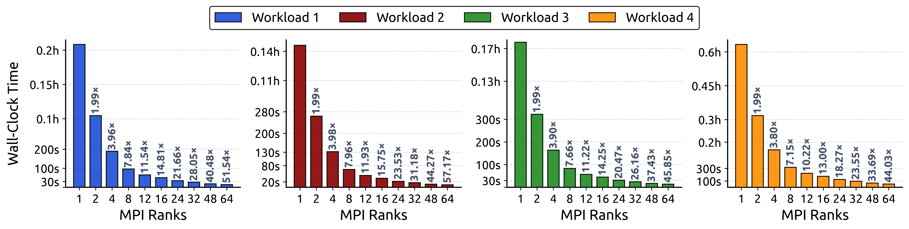
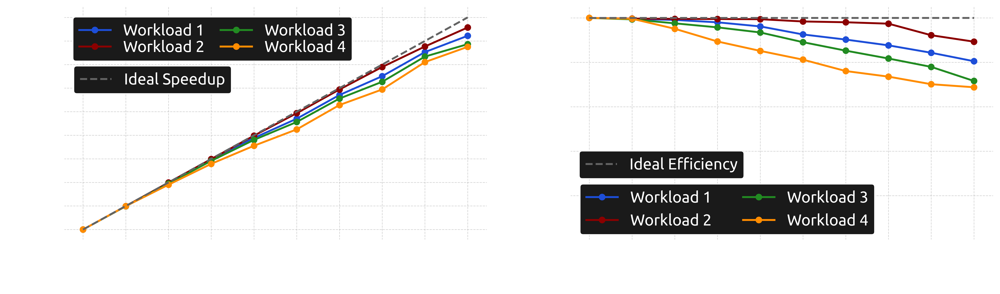
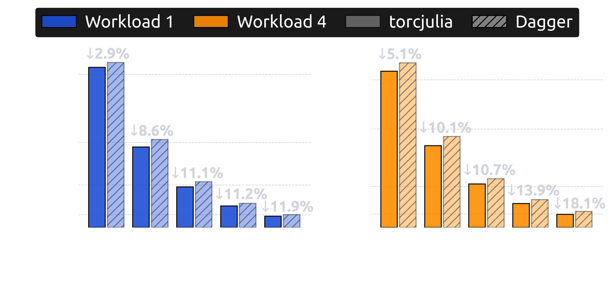

# 🚀 torcjulia: An MPI-based Runtime System for Asynchronous Task Parallelism in Julia

[](https://github.com/CEID-HPCLAB/torcjulia/releases/tag/v0.1.0)
[](https://opensource.org/licenses/MIT)<br>
[](https://julialang.org)


**torcjulia** is a platform-agnostic, high-performance package for **asynchronous many-task (AMT) parallelism** in Julia. Built on top of **Message Passing Interface (MPI)** and Julia's native multithreading, it employs a symmetric P2P model to dynamically orchestrate the concurrent execution of tasks across both shared and distributed memory platforms. 

By combining intra-node **work sharing** with inter-node **work stealing**, torcjulia provides **adaptive load balancing**, achieving efficient resource utilization across both regular and irregular workloads. Moreover, tasks can be nested arbitrarily, enabling applications to exploit **multiple levels** of parallelism, while the runtime engine can dynamically switch to the native Single Program Multiple Data (SPMD) programming model for direct integration of MPI code. Beyond task-based programming, torcjulia also supports **skeletal programming**, offering high-level abstractions that simplify the implementation of parallel applications at scale.


## Table of Contents
- [Overview](#overview)
  - [Asynchronous Many-Task (AMT) Parallelism](#asynchronous-many-task-amt-parallelism)
  - [Related Work](#related-work)
  - [torcjulia](#torcjulia)
- [Installation](#installation)
  - [Dependencies](#dependencies)
  - [ArgoDSM Integration](#argodsm-integration)
  - [Quick Start](#quick-start)
  - [Testing](#testing)
- [Software Architecture](#software-architecture)
  - [Execution Model](#execution-model)
  - [Task Scheduling](#task-scheduling)
  - [Work Stealing](#work-stealing)
  - [Distributed Shared Memory (DSM)](#distributed-shared-memory-dsm)
  - [Parallel Algorithmic Skeletons](#parallel-algorithmic-skeletons)
- [Application Programming Interface (API)](#application-programming-interface-api)
  - [Runtime Engine Setup](#runtime-engine-setup)
  - [Runtime Engine Query and Configuration](#runtime-engine-query-and-configuration)
  - [Low-level Application Setup](#low-level-application-setup)
  - [Environment Variables](#environment-variables)
  - [Dynamic Worker Management](#dynamic-worker-management)
  - [Task Management Routines](#task-management-routines)
  - [SPMD Programming Model with MPI](#spmd-programming-model-with-mpi)
  - [Distributed Shared Memory (ArgoDSM)](#distributed-shared-memory-argodsm)
  - [MPI Shared-Memory Windows](#mpi-shared-memory-windows)
  - [Algorithmic Skeletons](#algorithmic-skeletons)
- [Examples](#examples)
  - [Submit and Wait](#submit-and-wait)
  - [Task Arguments](#task-arguments)
  - [Task Dependencies](#task-dependencies)
    - [Nested Dependencies](#nested-dependencies)
  - [Task Prioritization](#task-prioritization)
  - [Task Pinning](#task-pinning)
  - [Task Scheduling Policies](#task-scheduling-policies)
  - [Worker Management](#worker-management)
  - [Callback Functions](#callback-functions)
    - [Reduction Operations](#reduction-operations)
  - [Nested Parallelism](#nested-parallelism)
  - [Work Stealing](#work-stealing-1)
  - [SPMD Execution Model](#spmd-execution-model)
    - [MPI Collective Operations](#mpi-collective-operations)
  - [MPI Interoperability](#mpi-interoperability)
  - [MPI Shared-Memory Windows](#mpi-shared-memory-windows-1)
  - [Distributed Shared Memory (ArgoDSM)](#distributed-shared-memory-argodsm-1)
  - [Algorithmic Skeletons](#algorithmic-skeletons-1)
      - [Map](#map)
      - [Starmap](#starmap)
      - [Reduce](#reduce)
      - [MapReduce](#mapreduce)
      - [MapPairs](#mappairs)
      - [MapPairsReduce](#mappairsreduce)
      - [Filter](#filter)
      - [Scan](#scan)
- [Performance Evaluation](#performance-evaluation)
    - [Experimental Setup](#experimental-setup)
      - [Workloads](#workloads)
      - [Hardware Configuration](#hardware-configuration)
    - [Scalability](#scalability)
    - [Comparison with Dagger](#comparison-with-dagger)
- [Reproducibility](#reproducibility)
    - [Figures](#regenerating-the-figures)
    - [Results](#reproducing-the-reported-results)
    - [Dagger](#dagger)
    - [Slurm](#slurm)
- [Repository Layout](#repository-layout)
- [Planned Features](#planned-features)
- [Acknowledgments](#acknowledgments)
- [Contact](#contact) 
- [References](#references)


## Overview

### Asynchronous Many-Task (AMT) Parallelism

In the *post-Moore* era, the ever-increasing demand for computational power has made cluster environments the prevalent platform for high-performance computing (HPC). 

However, the growing heterogeneity of modern parallel computing systems, in both hardware and software, poses significant **programmability** and **portability challenges**, often hindering efficient resource utilization. In this evolving landscape, **AMT programming models** have emerged as a productive alternative to address these challenges, providing a **high-level** paradigm for expressing parallelism across the hierarchical architecture of contemporary HPC systems. 

In task-based programming, applications are expressed as collections of **fine-grained tasks** that can be spawned at **different levels of parallelism** and executed across the processing units of a single node, a cluster, or a supercomputer. The tasks can be completely decoupled or part of an iterative algorithm in which the results of each step guide the next. Moreover, they can be regular or irregular, with varying granularity. Their execution is delegated to a **runtime system**, which dynamically schedules individual tasks across the available resources while respecting the underlying dependency graph. 

This allows programmers to focus on the problem at hand, abstracting away low-level execution concerns such as **load balancing**, **synchronization**, and **communication**. Such an abstraction is particularly attractive for **irregular**, **adaptive**, or **non-iterative workloads**, which are characterized by unpredictable dependencies, variable task execution times, and dynamic resource requirements, and are therefore challenging to implement efficiently using static loop-based decompositions or conventional bulk-synchronous parallel (BSP) models. 

> [!NOTE]
> Common examples of such applications include adaptive mesh refinement, particle-based methods, graph-based computations, and Markov Chain Monte Carlo (MCMC) algorithms.

> [!NOTE]
> For a detailed overview of AMT parallel programming models, their key characteristics, and their applications, see [[1](https://link.springer.com/article/10.1007/s11227-018-2238-4), [2](https://dl.acm.org/doi/10.1145/3840389)] .

### Related Work

Originally tailored for high-performance scientific computing, Julia provides built-in support for a variety of parallel computing paradigms. For shared-memory architectures, multithreading is supported through the [Threads](https://docs.julialang.org/en/v1/base/multi-threading/#Base.Threads) module. The [`@spawn`](https://docs.julialang.org/en/v1/base/multi-threading/#Base.Threads.@spawn) and [`@threads`](https://docs.julialang.org/en/v1/base/multi-threading/#Base.Threads.@threads) macros enable asynchronous task creation and parallel loop execution, respectively, while the [`wait`](https://docs.julialang.org/en/v1/base/parallel/#Base.wait) and [`fetch`](https://docs.julialang.org/en/v1/base/parallel/#Base.fetch-Tuple{Task}) routines provide mechanisms for task synchronization and result retrieval. 

For distributed-memory computing, Julia provides the [Distributed](https://docs.julialang.org/en/v1/stdlib/Distributed/#man-distributed) module that enables parallel computing across multiple processes, either on a single machine or across a multi-node cluster. Its programming model is built around two primitives, *remote references* and *remote calls*, with communication implemented over standard TCP.

> [!IMPORTANT]
> Although portable, the TCP-based communication approach used by Julia's [Distributed](https://docs.julialang.org/en/v1/stdlib/Distributed/#man-distributed) module cannot leverage specialized low-latency interconnects such as InfiniBand, thereby limiting attainable performance in HPC clusters.

Each of the aforementioned paradigms follows a different parallelism approach and employs its own API to exploit parallelism. As a result, combining their strengths within a hybrid execution model introduces challenges, particularly for users without HPC expertise. 

To address this, Alomairy *et al.* introduced `Dagger` [[3](https://ieeexplore.ieee.org/document/10938467)], a unified framework for dynamic task scheduling in heterogeneous environments. `Dagger` builds on the [Distributed](https://docs.julialang.org/en/v1/stdlib/Distributed/#man-distributed) module and adopts a macro-based sequential programming model, enabling users to spawn tasks using straightforward Julia code. Drawing inspiration from [Dask](https://github.com/dask/dask), it relies on a directed acyclic graph (DAG) scheduler that automatically detects and orchestrates data dependencies between tasks, while managing their distribution across available nodes.

To enable scalable execution on HPC clusters, Guimarães *et al.* developed an MPI-based backend for `Dagger` [[4](https://sc25.supercomputing.org/proceedings/posters/poster_files/post102s2-file3.pdf)]. Their experimental evaluation showed that, at large node counts, the proposed backend exhibits limited scalability and is consistently outperformed by the original implementation. As the authors acknowledge, the communication layer requires further optimization for large-scale HPC environments. 

More recently, Dastur *et al.* proposed `DistributedWorkflows` [[5](https://proceedings.juliacon.org/papers/10.21105/jcon.00181)], a high-level wrapper around [GPI-Space](https://www.gpi-space.de/) that enables researchers to express application parallelism through Petri net workflows.

> [!IMPORTANT]
> Although it offers an expressive programming model, the `DistributedWorkflows` package has several limitations. As an interface package, it relies on external tools beyond Julia and entails additional setup complexity. Moreover, it requires a shared file system whose high I/O overhead limits its applicability to long-running tasks.

Overall, existing task-based engines in Julia are primarily designed for general-purpose parallel programming, which can pose performance and scalability challenges when applied to tightly coupled HPC workloads characterized by **irregular task granularity**, **nested parallelism**, and **highly dynamic execution behavior**. 

Furthermore, they lack **direct interoperability** with applications based on the MPI, the *lingua franca* for inter-node communication in HPC, limiting their adoption in large-scale applications. Dynamic switching to the native SPMD execution model of MPI is also not supported. Futhermore, most require users to specify the available workers *a priori*, without supporting their **dynamic adjustment** at runtime. 

In addition, they provide limited **fine-grained control** over task scheduling and load balancing, which prevents expert users from incorporating application-specific knowledge into runtime decisions. Finally, their APIs lack support for **parallel algorithmic skeletons**, increasing the programming effort required to express common data-parallel computation patterns efficiently.

### torcjulia

`torcjulia` is a **platform-agnostic** package for AMT parallelism in Julia. Built on top of **MPI** [[6](https://proceedings.juliacon.org/papers/10.21105/jcon.00068)] and Julia's native multithreading, it employs a symmetric P2P model to dynamically orchestrate the concurrent execution of tasks on both shared and distributed memory platforms. To ensure efficient resource utilization, **adaptive load balancing** is achieved through a hybrid scheduling scheme that combines the *work sharing* and *work stealing* paradigms, while also supporting **task pinning** and **prioritization**. 

At the application level, `torcjulia` exposes a **high-level** API compatible with [Python Enhancement Proposal (PEP) 3148](https://peps.python.org/pep-3148/), abstracting task submission and synchronization through `submit` and `wait` calls. Moreover, a comprehensive set of **parallel algorithmic skeletons** is provided, enabling researchers from diverse domains to seamlessly scale their workloads from local workstations to multi-node clusters. 

Overall, `torcjulia` aims to extend Julia's HPC ecosystem by providing a **portable Julia-native** AMT runtime system that:

- Offers an **intuitive** programming model which simplifies the expression of task-based parallelism across both shared and distributed memory environments.

- Adopts an **MPI+X** model, transparently leveraging MPI primitives for inter-node communication and Julia-native multithreading for intra-node parallelism, while allowing MPI operations to be invoked at the application level. Dynamic switching to the typical **SPMD execution model** is also supported. 

- Supports **nested parallelism**, facilitating the implementation of parallel recursive algorithms.

- Automatically detects and orchestrates **data dependencies** between tasks.

- Takes advantage of MPI internally in a transparent to the user way but also allows the use of **legacy MPI code** at the application level.

- Integrates **inter-node work stealing** for load balancing, enhanced by a set of task distribution policies that can be customized by the user.

- Provides high-level functions that enable the use of **software-distributed shared memory (S-DSM)** at the application level.

- Supports a wide range of **parallel algorithmic skeletons**, including `map`, `reduce`, `mapReduce`, and `filter`.

- Enables **dynamic spawning** and **termination** of MPI worker processes at runtime.

- Exposes the above features through a **user-friendly API** that encapsulates asynchronous task execution via ***futures*** (task descriptors).

> [!NOTE]
> The core execution model of `torcjulia` is inspired by `TORC` [[7](https://ieeexplore.ieee.org/document/6169554)], a C runtime library for task-based parallelism on heterogeneous clusters. `TORC` has been employed for a wide range of applications, including optimization, uncertainty quantification, and numerical differentiation. A high-level Python implementation, namely `torcpy` [[8](https://www.sciencedirect.com/science/article/pii/S2352711020300091)], has also been developed and primarily used in machine learning workflows. 
>
> `torcjulia` combines the core principles of `TORC` with the programmability of `torcpy` while introducing a set of new features, including parallel algorithmic skeletons, task prioritization, dynamic worker management, and software-based DSM support, providing a robust AMT runtime system for Julia that can be adopted across a broad range of large-scale workloads.

## Installation

Clone the repository and navigate to the project directory:
```bash
git clone https://github.com/CEID-HPCLAB/torcjulia.git
cd torcjulia
```
> [!IMPORTANT]
> Before installing `torcjulia`, ensure that Julia (`version 1.11` or later) is installed on your system.

### Dependencies

To install the dependencies required by `torcjulia`, launch the `Julia REPL` from the repository root and run the following commands: 
```julia
julia> using Pkg
julia> Pkg.activate("./torcjulia")
julia> Pkg.instantiate()
```

> [!WARNING]
> By default, [MPI.jl](https://github.com/JuliaParallel/MPI.jl) uses `MPICH_jll` on non-Windows platforms and `MicrosoftMPI_jll` on Windows. No separate MPI installation is required. To use a different MPI implementation, configure the desired backend using [MPIPreferences.jl](https://juliaparallel.org/MPI.jl/stable/reference/mpipreferences/). For details, see the [MPI.jl configuration guide](https://juliaparallel.org/MPI.jl/stable/configuration/).

> [!WARNING]
> The `main` branch of the `torcjulia` repository does not include [ArgoDSM](https://github.com/etascale/argodsm) integration. To use `torcjulia` with DSM support provided by `ArgoDSM` first check out the [*`ArgoDSM`*](https://github.com/phadjido/torc_julia/tree/argoDSM) branch and then install the required dependencies by executing the commands listed above.

### ArgoDSM Integration

To enable DSM support in the `torcjulia` runtime environment, after activating the project environment and installing the required dependencies, execute the following commands to build and configure `ArgoDSM`:
```bash
cd ArgoDSM
bash build.sh
```

> [!NOTE]
> The compiled libraries are placed in `torcjulia/argodsm/src/libs`.

> [!NOTE]
> To disable `ArgoDSM` runtime statistics, set the `ARGO_PRINT_STATISTICS` environment variable to `0` before launching the application.

To make `torcjulia` available in your Julia environment, activate the environment and add the local package:
```julia
julia> using Pkg
julia> Pkg.activate(".") # Assumes the Julia environment is located at the repository root
julia> Pkg.develop(path="./torcjulia")
```
> [!TIP]
> To verify that `torcjulia` package has been added successfully to the active Julia environment, run `using torcjulia` in the `Julia REPL`.

### Quick Start

Once installed, `torcjulia` can be loaded in the project environment using the following command:
```julia
using torcjulia
```

To verify the installation and configuration of `torcjulia` and demonstrate how its API supports task submission and synchronization, run the following example:
```julia
using torcjulia

double(x::Int)::Int = 2 * x

square(x::torcjulia.Future)::Int = torcjulia.result(x)^2

function add(x::torcjulia.Future, y::torcjulia.Future, z::torcjulia.Future)::Int
  torcjulia.result(x) + torcjulia.result(y) + torcjulia.result(z)
end

"""
Task dependency DAG:

  taskA ──────┬──────────────┐
              │              │
              ▼              │
            taskB ───────────┤
                             │
  taskC ─────────────────────▼
                           taskD
"""

function main()
  init_value = 5

  taskA = torcjulia.submit(double, init_value) # Computes 2 * 5 = 10

  # taskB depends on taskA and executes after taskA completes
  taskB = torcjulia.submit(square, taskA) # Computes 10² = 100

  taskC = torcjulia.submit(double, init_value - 3) # Computes (5 - 3) * 2 = 4

  # taskD depends on taskA, taskB, and taskC
  taskD = torcjulia.submit(add, taskA, taskB, taskC) # Computes 10 + 100 + 4 = 114

  # Wait for taskD to complete
  torcjulia.wait(taskD)

  @assert torcjulia.result(taskD) == 114
end

torcjulia.init(main)
```

The example can be executed using the following command:
```bash
mpiexecjl -n <num_MPI_processes> julia --project=<path_to_environment> --threads <num_threads_per_process>,0 <path_to_file.jl> 
```

> [!TIP] 
> Replace the placeholders with the desired number of MPI processes, the path to the Julia environment, the number of Julia threads per process, and the path to the script. For Julia versions earlier than `1.12`, omit `,0` from the `--threads` argument.

> [!IMPORTANT] 
> `mpiexecjl` is a project-aware MPI launcher provided by [MPI.jl](https://github.com/JuliaParallel/MPI.jl). Since different Julia projects can be configured to use different MPI implementations, selecting the appropriate `mpiexec` executable can otherwise be cumbersome. The `mpiexecjl` wrapper addresses this by selecting the launcher associated with the specified Julia project through the `--project` option. To use it, run `MPI.install_mpiexecjl` in the `Julia REPL` after loading MPI, and add the installation directory (by default, `~/.julia/bin`) to your `PATH`. For further details, see the [MPI.jl documentation](https://juliaparallel.org/MPI.jl/stable/usage/#Julia-wrapper-for-mpiexec).

> [!WARNING] 
> When launching `torcjulia` with multiple MPI processes, one thread in each process is dedicated to handling task coordination and does not execute tasks (see [Software Architecture](#software-architecture)). Therefore, each process must be configured with at least **two** threads whenever `MPI.NUM_PROCS > 1`. You can set the number of threads per process using the `-t/--threads` command-line option or the `JULIA_NUM_THREADS` environment variable.

### Testing

Using the [`master_worker.jl`](./examples/master_worker.jl) example, we demonstrate the fundamental *master-worker* paradigm in `torcjulia` with varying numbers of MPI processes and Julia threads per process.

The task function (`work`) takes an input value `x`, sleeps for one second, computes its square, and returns the result. The main application task, which runs on the main thread of the master process, spawns `ntasks` tasks. By default, these tasks are distributed among the available workers in a *round-robin* fashion (see [Scheduling Policies](#task-scheduling-policies)). The main task then calls `wait` to block until all spawned tasks have completed. While waiting, the master's main thread actively participates in executing tasks rather than remaining idle. Finally, it prints the results and reports the elapsed execution time.

```julia
using torcjulia

function work(x::Int)::Int
  sleep(1)
  
  y = x^2

  println("Work: input = $x, output = $y on worker thread $(torcjulia.worker_local_id()) \
          of node $(torcjulia.node_id()).")
  y
end

function main()
  ntasks = 8
  
  inputs = 1:ntasks

  t0 = torcjulia.gettime()

  tasks = [torcjulia.submit(work, x) for x in inputs]
  torcjulia.wait(tasks)

  elapsed = torcjulia.gettime() - t0
  
  for (i, task) in enumerate(tasks)
      y = torcjulia.result(task)
      println("Task $i: $(inputs[i])² = $y.")
  end

  println("Total elapsed time: $(round(elapsed, digits = 3)) seconds.")
end

torcjulia.init(main)
```


> [!NOTE]
> Calling `torcjulia.init(main)` initializes the tasking library and runs the primary application task (`main`) on the main thread of the master process (`MPI rank 0`).


#### An MPI Process with a worker thread

This execution mode is similar to sequential execution, except that task functions are submitted for asynchronous (*deferred*) execution. No MPI communication is involved, as tasks are enqueued directly in the local task queue. When `wait` is called, the main task (`main`) suspends, and the worker thread starts executing the child tasks. Once all child tasks have completed, the main task resumes and prints the results.

```console
$ mpiexecjl -np 1 julia --project=<path/to/julia/environment> --threads 1,0 <path/to/script>.jl
torcjulia: main starts
Work: input = 1, output = 1 on worker thread 1 of node 0.
Work: input = 2, output = 4 on worker thread 1 of node 0.
Work: input = 3, output = 9 on worker thread 1 of node 0.
Work: input = 4, output = 16 on worker thread 1 of node 0.
Work: input = 5, output = 25 on worker thread 1 of node 0.
Work: input = 6, output = 36 on worker thread 1 of node 0.
Work: input = 7, output = 49 on worker thread 1 of node 0.
Work: input = 8, output = 64 on worker thread 1 of node 0.
Task 1: 1² = 1.
Task 2: 2² = 4.
Task 3: 3² = 9.
Task 4: 4² = 16.
Task 5: 5² = 25.
Task 6: 6² = 36.
Task 7: 7² = 49.
Task 8: 8² = 64.
Total elapsed time: 8.41 seconds.
torcjulia [node 0]: created = 8, executed = 8, stole = 0, stolen = 0, steal_attempts = 0, max_queue_depth = 1
torcjulia [tasks]: average pending time = 3.601s, average execution time = 1.003s
```

#### An MPI process with two worker threads

The MPI process is launched with two threads. As in the previous configuration, no MPI communication takes place, and submitted tasks are enqueued in the local task queue. When `wait` is called, the main thread also participates in task execution alongside the second thread, allowing both threads to execute tasks concurrently. Given the uniform task granularity, this configuration achieves an approximately 2× speedup over sequential execution.

```console
$ mpiexecjl -np 1 julia --project=<path/to/julia/environment> --threads 2,0 <path/to/script>.jl
torcjulia: main starts
Work: input = 1, output = 1 on worker thread 2 of node 0.
Work: input = 2, output = 4 on worker thread 1 of node 0.
Work: input = 4, output = 16 on worker thread 1 of node 0.
Work: input = 3, output = 9 on worker thread 2 of node 0.
Work: input = 6, output = 36 on worker thread 2 of node 0.
Work: input = 5, output = 25 on worker thread 1 of node 0.
Work: input = 8, output = 64 on worker thread 1 of node 0.
Work: input = 7, output = 49 on worker thread 2 of node 0.
Task 1: 1² = 1.
Task 2: 2² = 4.
Task 3: 3² = 9.
Task 4: 4² = 16.
Task 5: 5² = 25.
Task 6: 6² = 36.
Task 7: 7² = 49.
Task 8: 8² = 64.
Total elapsed time: 4.434 seconds.
torcjulia [node 0]: created = 8, executed = 8, stole = 0, stolen = 0, steal_attempts = 0, max_queue_depth = 1
torcjulia [tasks]: average pending time = 1.587s, average execution time = 1.007s
```

#### Two MPI processes with one worker thread

Two MPI processes are launched, each configured with one worker thread and one manager thread (hence `--threads 2,0`). The primary task runs on the main thread of the master process (`MPI rank 0`) and spawns eight tasks. By default, the tasks are assigned to the worker threads according to a round-robin scheduling policy. Consequently, tasks 1, 3, 5, and 7 are assigned to the worker thread on MPI rank 0, while tasks 2, 4, 6, and 8 are assigned to the worker thread on MPI rank 1.

> [!NOTE]
> Compared with the previous configuration, in which two worker threads execute tasks within a single MPI process, this configuration results in a slightly longer elapsed time, despite using the same number of worker threads. This difference arrises from the communication overhead associated with running two separate MPI processes. In the previous configuration, both worker threads reside within the same process, eliminating the need for inter-process MPI communication.

```console
$ mpiexecjl -np 2 julia --project=<path/to/julia/environment> --threads 2,0 <path/to/script>.jl
torcjulia: main starts
Work: input = 1, output = 1 on worker thread 1 of node 0.
Work: input = 2, output = 4 on worker thread 1 of node 1.
Work: input = 3, output = 9 on worker thread 1 of node 0.
Work: input = 4, output = 16 on worker thread 1 of node 1.
Work: input = 5, output = 25 on worker thread 1 of node 0.
Work: input = 6, output = 36 on worker thread 1 of node 1.
Work: input = 7, output = 49 on worker thread 1 of node 0.
Work: input = 8, output = 64 on worker thread 1 of node 1.
Task 1: 1² = 1.
Task 2: 2² = 4.
Task 3: 3² = 9.
Task 4: 4² = 16.
Task 5: 5² = 25.
Task 6: 6² = 36.
Task 7: 7² = 49.
Task 8: 8² = 64.
Total elapsed time: 4.503 seconds.
torcjulia [node 0]: created = 8, executed = 4, stole = 0, stolen = 0, steal_attempts = 0, max_queue_depth = 1
torcjulia [node 1]: created = 0, executed = 4, stole = 0, stolen = 0, steal_attempts = 0, max_queue_depth = 0
torcjulia [tasks]: average pending time = 1.643s, average execution time = 1.003s
```

#### Two MPI processes with two worker threads each (MPI+X model)

Two MPI processes are launched, each with two worker threads. Worker threads 1 and 2 belong to `MPI rank 0`, while worker threads 3 and 4 belong to `MPI rank 1`. Under the round-robin scheduling policy, the first four tasks are assigned to the workers on `MPI rank 0`, and the remaining four to the workers on `MPI rank 1`. Given the uniform task granularity, this configuration results in an approximately 4× speedup over sequential execution.

```console
$ mpiexecjl -np 2 julia --project=<path/to/julia/environment> --threads 3,0 <path/to/script>.jl
torcjulia: main starts
Work: input = 1, output = 1 on worker thread 2 of node 0.
Work: input = 2, output = 4 on worker thread 1 of node 0.
Work: input = 4, output = 16 on worker thread 2 of node 1.
Work: input = 3, output = 9 on worker thread 1 of node 1.
Work: input = 5, output = 25 on worker thread 2 of node 0.
Work: input = 6, output = 36 on worker thread 1 of node 0.
Work: input = 7, output = 49 on worker thread 1 of node 1.
Work: input = 8, output = 64 on worker thread 2 of node 1.
Task 1: 1² = 1.
Task 2: 2² = 4.
Task 3: 3² = 9.
Task 4: 4² = 16.
Task 5: 5² = 25.
Task 6: 6² = 36.
Task 7: 7² = 49.
Task 8: 8² = 64.
Total elapsed time: 2.527 seconds.
torcjulia [node 0]: created = 8, executed = 4, stole = 0, stolen = 0, steal_attempts = 0, max_queue_depth = 1
torcjulia [node 1]: created = 0, executed = 4, stole = 0, stolen = 0, steal_attempts = 0, max_queue_depth = 0
torcjulia [tasks]: average pending time = 0.621s, average execution time = 1.007s
```

## Software Architecture

In `torcjulia`, an application is abstracted into a hierarchy of tasks, with user code serving as the *top-level* task. Parallelism is expressed through task submissions, each defined by a user-provided function with optional positional and/or keyword arguments.

Arguments may include *futures* referring to the results of previously submitted tasks, thereby expressing *data dependencies*. The runtime system **automatically** detects these dependencies and **dynamically** schedules ready tasks across available processing units to exploit concurrency, ensuring load balancing.

> [!NOTE] 
> Explicit synchronization between tasks is provided through high-level functions, enabling users to precisely coordinate task execution when required. Execution parameters, such as *processor affinity* and *priority level*, can also be specified in task submissions, providing fine-grained control over task scheduling.

As shown in **Figure 1**, the runtime engine of `torcjulia` is based on a symmetric P2P model, on top of which an **MPI+X** parallelism scheme is employed for the concurrent execution of tasks. Inter-node communication relies on the [MPI.jl](https://github.com/JuliaParallel/MPI.jl), which provides Julia bindings for MPI, while intra-node parallelism is supported by Julia's [Threads](https://docs.julialang.org/en/v1/base/multi-threading/#Base.Threads) module. Within each MPI process, inter-thread coordination is achieved through thread-safe queues provided by the [ConcurrentCollections.jl](https://github.com/JuliaConcurrent/ConcurrentCollections.jl). 

<p align = "center">
  <picture>
    <source media = "(prefers-color-scheme: dark)" srcset = "docs/Fig1_dark.png">
    <source srcset = "docs/Fig1_light.png" media = "(prefers-color-scheme: light)">
    
  </picture>
  <br>
  <em>
    Figure 1: High-level architecture of the torcjulia AMT runtime system</a>
  </em>
</p>

### Execution Model

A `torcjulia`-based application consists of multiple MPI processes ❶ running on cluster nodes, each hosting a fixed size pool of Julia worker threads ❷. In addition to these threads, each MPI process maintains a dedicated manager thread ❸ that handles all remote task- and data-coordination operations, such as serving incoming task stealing requests. These operations are performed asynchronously using explicit MPI primitives that remain **completely transparent** to the user. 

Using MPI-2 dynamic process management routines, the number of MPI processes can be **dynamically adjusted** at runtime (see [Dynamic Worker Management](#worker-management)), which is particularly useful for workloads with time-varying computational demands. Moreover, tasks can be spawned at multiple parallelism levels from any participating MPI process, enabling **nested parallelism** (see [Nested Parallelism](#nested-parallelism)). 

> [!IMPORTANT] 
> In addition to task-based execution, `torcjulia` supports MPI's **SPMD** programming model allowing direct integration of MPI code (see [MPI Interoperability](#mpi-interoperability)). This enables existing MPI-based applications to incorporate task-based parallelism without modifying their established communication code, addressing a key barrier to adopting AMT runtimes in legacy HPC codebases.

> [!NOTE]
> In pure multithreaded mode, all threads participate in task execution, and communication takes place exclusively through shared memory. Consequently, no dedicated manager thread is required.

> [!NOTE]
> All MPI processes participate in task execution without a dedicated master process.

### Task Scheduling

Upon submission, a scheduling policy determines the MPI rank to which each task is assigned (see [Task Scheduling Policies](#task-scheduling-policies)). Multiple policies are provided, including *round-robin* and *weighted round-robin*. User-defined policies are also supported, allowing application-specific knowledge to be incorporated into runtime decisions. 

Each MPI rank maintains *hierarchical task queues* ❹, into which the assigned ready-to-run tasks are placed according to their priority and spawning level. 

Worker threads continuously extract tasks from these local queues, with high-priority tasks served first, process each task upon retrieval, and return the corresponding result to the manager thread of the MPI rank that spawned the task. 

Among *general-purpose* tasks, i.e., those assigned the default priority, tasks from higher spawning levels (*coarse-grained* tasks) are prioritized, while tasks at the same level are retrieved in FIFO order.

> [!IMPORTANT] 
> By decoupling workers from tasks, worker threads **never block** within the dispatch loop. Whenever a task reaches a synchronization point and waits for the completion of previously submitted tasks, the worker suspends its execution and proceeds with another pending task. Once the awaited tasks have been completed, the worker resumes execution of the suspended task.

### Work Stealing

Beyond *work sharing*, `torcjulia` also employs a *work stealing* mechanism that follows an *on-demand* approach, initiating work stealing only when needed, without requiring global knowledge of system load. 

Specifically, an idle worker thread first attempts to retrieve work from its local workpile. If no tasks are available locally, it issues a synchronous task stealing request to the manager thread of the next, according to the rank, MPI process. If the request yields no work, the worker proceeds to the next rank and repeats the process until a pending task is obtained or all MPI ranks have been queried. 

> [!IMPORTANT] 
> This *work-first, help-then* policy provides adaptive load balancing, minimizing processor idle time even for highly irregular workloads (see [Work Stealing](#work-stealing-1)).

### Distributed Shared Memory (DSM)

`torcjulia` builds on `ArgoDSM` [[9](https://dl.acm.org/doi/10.1145/2749246.2749250)], a state-of-the-art page-based DSM (PDSM) system, to provide application-level support for software-distributed shared memory (S-DSM) ❺.

> [!NOTE]
> DSM systems provide coherent global address spaces across distributed memory environments, extending the shared-memory programming model beyond the scale of single-node systems. PDSM is a common approach to S-DSM that implements the shared memory abstraction through the virtual memory system. 

Users only need to explicitly allocate the corresponding shared memory regions through the `pdsm_alloc` function (see [Distributed Shared Memory](#distributed-shared-memory-argodsm-1)). The runtime transparently manages the underlying communication and synchronization using the primitives provided by `ArgoDSM`, allowing the allocated data to be accessed within tasks as in shared-memory programming.

Beyond PDSM, `torcjulia` also supports the *MPI shared memory* paradigm, enabling processes within a shared memory island to directly map memory regions into a global shared address space. Shared-memory windows are allocated through the `shw_alloc` function, while the underlying MPI-3 RMA operations are handled internally by the runtime (see [MPI Shared-Memory Windows](#mpi-shared-memory-windows-1)). 

> [!IMPORTANT]
> This paradigm can reduce memory consumption by avoiding data replication across tasks running on different MPI processes.

### Parallel Algorithmic Skeletons

`torcjulia` provides built-in support for **seven** parallel algorithmic skeletons, including `map`, `filter`, and `reduce`.

> [!NOTE]
> Algorithmic skeletons are generic, high-level programming constructs that abstract common data-parallel computation patterns. Derived from higher-order functions, they can be parameterized with application-specific sequential code while their parallel orchestration is encapsulated by a runtime system. By composing skeletons, users can build structured, high-level specifications of complex parallel workflows. 

Each skeleton is exposed as a function that typically takes two main arguments: one or more iterable objects containing the input data and a user-defined function specifying the operation to be applied to them (see [Algorithmic Skeletons](#algorithmic-skeletons-1)). Internally, the runtime system decomposes the underlying computation pattern into a set of asynchronous tasks and transparently orchestrates their parallel execution. 

> [!IMPORTANT]
> In `torcjulia`, algorithmic skeletons can be composed sequentially, by passing the output of one skeleton as input to another, or hierarchically, by nesting one skeleton within another.

> [!NOTE] 
> To the best of our knowledge, `torcjulia` is the first Julia-native AMT runtime system to support *skeletal programming* across both shared and distributed memory environments.

## Application Programming Interface (API)

Inspired by [PEP 3148](https://peps.python.org/pep-3148/), `torcjulia` provides a high-level interface similar to Python's [concurrent.futures](https://docs.python.org/3/library/concurrent.futures.html) module. 

Tasks are submitted through the `submit` function, which asynchronously schedules their execution and returns a *future* representing the pending result of the task function. Execution parameters, including the scheduling policy for the submitted task, can be specified as keyword arguments to `submit`. 

Upon task completion, the result is stored in the corresponding *future* object and can be retrieved using the `result` method. Synchronization is achieved through the `wait` function, which blocks the execution of the calling task until a specified set of previously submitted tasks have been completed.  

Skeletons are exposed through dedicated functions, while the number of MPI processes can be dynamically adjusted using the `add_worker` and `remove_worker` functions. 

Additional routines are provided for engine setup, querying the runtime environment, configuring the scheduling policy, and controlling the work-stealing mechanism.  

### Runtime Engine Setup

- ```julia
  init(func::Function; MPI_finalize::Bool = true)
  ```

  Initializes `torcjulia` runtime and launches `func` as the primary application task on the main thread of the MPI process with rank 0 (master process). When `func` completes, the runtime shuts down. If `MPI_finalize` is `true` (the default), the underlying MPI environment is also finalized; otherwise, MPI remains active. This allows the library to be initalized and shut down multiple times within the same application. For futher details, see [this example](./examples/mpi_interoperability.jl).

- ```julia
  argo_init(memory::Int, cache::Int)
  ```

  Initializes the `ArgoDSM` system. The `memory` argument specifies the amount of memory allocated to `ArgoDSM`, while `cache` determines the amount of memory allocated to its cache. Both arguments are specified in bytes.

> [!WARNING]
> The `argo_init` function must be called before initializing the `torcjulia` runtime to enable DSM support in the `torcjulia` environment. If DSM functionality is not required, this initialization step can be omitted.

### Runtime Engine Query and Configuration

- ```julia 
  node_id()::Int 
  ``` 

  Returns the rank of the calling MPI process.
  
- ```julia
  num_nodes()::Int
  ```

  Returns the total number of MPI processes used by the `torcjulia` runtime.

- ```julia
  num_workers()::Int 
  ```
  
  Returns the total number of worker threads used by the `torcjulia` runtime.

- ```julia
  num_local_workers()::Int
  ```

  Returns the number of worker threads per MPI process.

- ```julia
  worker_local_id()::Int
  ```

  Returns the ID of the calling worker thread within its MPI process.

- ```julia 
  worker_id()::Int 
  ``` 

  Returns the global ID of the calling worker thread across all MPI processes. 

> [!NOTE] 
> When `torcjulia` is launched with $N$ MPI processes, each running $T$ worker threads, calling `worker_id` from the $k$-th worker thread of the MPI process with rank $r$ returns $r$ * $T$ + $k$, where $0 \leq r < N$ and $1 \leq k \leq T$.
>
> For example, with $2$ MPI processes and $4$ worker threads per process, calling `worker_id` from the third worker thread on `MPI rank 1` returns $1 * 4 + 3 = 7$.

> [!TIP]
> For usage examples of the runtime query routines provided by `torcjulia`, see [this example](./examples/worker-management/query.jl).

- ```julia
  enable_stealing() 
  ```

  Activates the inter-node work stealing mechanism.

- ```julia
  disable_stealing() 
  ```

  Deactivates the inter-node work stealing mechanism.

- ```julia
  is_stealing_enabled()::Bool 
  ```

  Returns `true` if the inter-node work stealing mechanism is enabled, and `false` otherwise.

> [!WARNING] 
> Work stealing is disabled by default. Call `torcjulia.enable_stealing` to activate the work-stealing mechanism.

> [!TIP]
> Enabling work stealing is recommended for applications with irregular workloads.

- ```julia
  set_scheduling_policy(policy::Symbol, weights::Union{Vector{Int}, Nothing} = nothing)
  ```

  Sets the task scheduling policy used by the `torcjulia` runtime.

  The `policy` argument specifies the scheduling policy and must be one of the following `Symbols`:
  
  - `:ROUND_ROBIN`: Distributes tasks across MPI processes in a round-robin (cyclic) fashion.
  
  - `:WRR`: Distributes tasks according to the specified `weights`, with one weight per MPI process.
  
  - `:LOCAL`: Assigns each task to the MPI process that submitted it.
  
  - `:RANDOM`: Assigns each task to a randomly selected MPI process.

  The `weights` argument is used only when `policy` is `:WRR`. It must be a vector of integers, with each element specifying the relative computational capacity of the corresponding MPI node. These weights determine the proportion of tasks assigned to each node.
  
  For example, given four MPI nodes and weights `[1, 1, 2, 3]`, tasks are distributed according to a `1:1:2:3` ratio. Thus, node `0` and `1` receive an equal share of tasks, node `2` receives twice as many tasks as either node `0` or node `1`, and node `3` receives three tasks as many, assuming a sufficiently large number of tasks (see [Task Scheduling Policies](#task-scheduling-policies)).

  For all other policies, `weights` is ignored.

> [!TIP]
> Standard *round-robin* scheduling is a special case of `WRR` in which all MPI nodes are assigned an equal weight of `1`.
  
> [!NOTE] 
> For a detailed overview of the scheduling policies supported by `torcjulia`, including how to configure them using `torcjulia.set_scheduling_policy`, see [this example](./examples/scheduling-policies/set_policy.jl).

- ```julia
  get_scheduling_policy()::torcjulia.DistributionPolicy
  ```

  Returns the task scheduling policy used by the `torcjulia` runtime environment.

- ```julia
  set_logger_level(level::LogLevel)
  ```

  Sets the minimum severity level for the `torcjulia` logger. Supported levels are `Debug`, `Info`, `Warn`, and `Error` (default: `Debug`).

### Low-level Application Setup

- ```julia 
  init()
  ```
  
  Initializes the runtime environment of `torcjulia`. If launching with multiple MPI processes, the last thread of each MPI process is reserved for the manager thread.

- ```julia
  launch(func::Function)
  ```
  
  Launches the application's main function `func` (i.e., the *top-level* task) on the main thread of the master node (`MPI rank 0`) and starts worker threads to handle the execution of incoming tasks.

- ```julia
  finalize(MPI_finalize::Bool)
  ```
  
  Finalizes the `torcjulia` runtime environment. If `MPI_finalize` is `true`, it also finalizes the MPI environment.

> [!NOTE]
> If the `torcjulia` runtime was launched with DSM support, calling `finalize` also shuts down the `ArgoDSM` system and releases its associated resources.

### Environment Variables

- `TORCJULIA_DISTRIBUTION_POLICY` (`String`): Specifies the task scheduling policy used by the `torcjulia` runtime. Accepted values are `ROUND_ROBIN` (default), `WRR`, `LOCAL`, and `RANDOM`. Values are case-insensitive. If an invalid value is provided, the runtime falls back to `ROUND_ROBIN`.

- `TORCJULIA_STEALING` (`Bool`): Controls whether inter-node work stealing is enabled. Accepted values are case-insensitive. Work stealing is disabled by default. If an invalid value is provided, work stealing remains disabled.

> [!NOTE]
> Setting `TORCJULIA_STEALING` to `true` enables the work-stealing mechanism.

- `TORCJULIA_WORKER_YIELDTIME` (`Float64`): Specifies the number of seconds an idle worker thread sleeps before resuming execution, releasing the processor it was running on (default: `0.01`).

- `TORCJULIA_MANAGER_YIELDTIME` (`Float64`): Specifies the number of seconds an idle manager thread sleeps before resuming execution, releasing the corrresponding processor (default: `0.01`).

### Dynamic Worker Management

- ```julia
  add_worker(; num_procs::Int = 1, weights::Union{Vector{Int}, Nothing} = nothing)
  ```

  Launches additional MPI processes in the `torcjulia` runtime environment.
    
  The `num_procs` parameter specifies the number of new MPI processes to launch.

  The `weights` parameter is an optional vector of integers specifying the weight for each new process, which is required if the selected distribution policy is *weighted round-robin* (`WRR`). The length of `weights` must match `num_procs`.

> [!IMPORTANT]
> Each new MPI process is launched with the same number of Julia threads as the MPI processes used to initially launch the `torcjulia` runtime environment.

- ```julia
  remove_worker(; node_id::Int)
  ```

  Removes the specified MPI process from the `torcjulia` runtime environment.

  The `node_id` parameter specifies the rank of the MPI process to remove.

> [!WARNING]
> Only MPI processes added after the initial launch of the `torcjulia` runtime environment can be removed.

### Task Management Routines

- ```julia
  submit(func::Function, args...;
         node::Int = -1,
         callback::Union{Function, Nothing} = nothing,
         async_callback::Bool = true, forced_node::Bool = false,
         priority::torcjulia.TaskPriorityLevel = torcjulia.TaskPriority.low,
         distribution_policy::Union{Function, Tuple, Symbol, Nothing} = nothing,
         kwargs...)::torcjulia.Future
  ```     
    
  Creates and submits a task for asynchronous execution of the function `func` with the given positional (`args`) and keyword (`kwargs`) arguments.

  Returns a `Future` object that can be used to retrieve the result of the task once it has completed.

  - `node`: The rank of the MPI process to which the task should be assigned. If not specified, the task is assigned according to the current scheduling policy, which can be configured via the `TORCJULIA_DISTRIBUTION_POLICY` environment variable or by calling `torcjulia.set_scheduling_policy`.  

  - `callback`: A `Function` invoked on the MPI process that submitted the task when the task completes and its results become available. The callback is called with the task's execution results as input. If `async_callback` is `true`, the callback is scheduled for asynchronous execution; otherwise, it is executed immediately.

  - `forced_node`: Determines whether the task is pinned to the target MPI process (default: `false`). If `true`, the task remains assigned to that process and cannot be stolen by workers on other processes. If `false`, the task may be stolen by worker threads on other MPI processes when work stealing is enabled.

  - `priority`: Specifies the task's priority level. Supported values are `TaskPriority.low`, `TaskPriority.medium`, and `TaskPriority.high` (default: `TaskPriority.low`).

  - `distribution_policy`: If specified, this argument overrides both the `node` parameter and the default task distribution policy for the submitted task. It can be a user-provided `Function`, a `Tuple`, or a `Symbol` specifying the desired distribution policy (e.g., `:ROUND_ROBIN`). When a `Function` is provided, either directly or as part of a tuple, it must return the rank of the MPI process to which the task will be assigned. In the `Tuple` form, the function is invoked with the specified arguments.

- ```julia 
  wait(tasks::Union{Vector{torcjulia.Future}, torcjulia.Future, Nothing} = nothing; 
       return_completed::Bool = false)::Union{Vector{torcjulia.Future}, Nothing}
  ```
  
  Blocks the execution of the calling task until the specified task or tasks have completed.

  If `tasks` is omitted, waits for all child tasks spawned by the calling task to complete.

  If `return_completed` is `true`, returns a `Vector` of `Future` objects corresponding to the completed tasks.


- ```julia
  submit_wait(func::Function, args...; kwargs...)
  ```
  
  Implements the *submit-wait* pattern by submitting `func` for execution with the provided positional (`args`) and keyword (`kwargs`) arguments, waiting for the submitted task to complete, and returning its result.

- ```julia
  result(task::torcjulia.Future)
  ```
  
  Returns the output of the task function stored in the descriptor of `task`.

- ```julia
  input(task::torcjulia.Future)
  ```
  
  Returns the positional arguments of the task function stored in the descriptor of `task`.

- ```julia
  kw_input(task::torcjulia.Future)
  ```
  
  Returns the keyword arguments of the task function stored in the descriptor of `task`.

> [!IMPORTANT]
> By default, skeleton invocations in `torcjulia` include an implicit barrier that waits for all spawned tasks to complete. The `map` and `starmap` skeletons also provide asynchronous variants that return an `AsyncResult` object representing the ongoing computation and its eventual result.

- ```julia
  ready(skeleton::AsyncResult)::Bool
  ```

  Returns `true` if all tasks associated with the asynchronous algorithmic skeleton represented by `skeleton` have completed, and `false` otherwise.

- ```julia
  wait(skeleton::AsyncResult)
  ```

  Waits for all tasks associated with the asynchronous algorithmic skeleton represented by `skeleton` have completed.

- ```julia
  get(skeleton::AsyncResult)
  ```

  Waits for all tasks associated with the asynchronous algorithmic skeleton represented by `skeleton` have completed and returns the resulting `Vector`.

### SPMD Programming Model with MPI

- ```julia
  spmd(func::Function, args...; return_completed::Bool = true, kwargs...)`
  ```

  Dynamically switches the execution model of the `torcjulia` runtime environment from AMT to SPMD mode, allowing MPI code to be executed directly within the calling function.

  Executes `func` on all MPI processes in the `torcjulia` runtime environment, passing the specified positional (`args`) and keyword (`kwargs`) arguments to each invocation.

  If `return_completed` is `true`, returns the `Future` objects corresponding to the completed tasks.

### Distributed Shared Memory (ArgoDSM)

- ```julia
  pdsm_alloc(size::Int, T::Type)
  ```

  Allocates a distributed shared-memory array of type `T` across the MPI processes using `ArgoDSM` and returns the allocated array.

  The `size` argument specifies the number of elements to allocate, not the allocation size in bytes.

- ```julia
  argo_barrier(tag::Int)
  ``` 
  
  Wrapper for the `argo_barrier` function provided by `ArgoDSM`.

### MPI Shared-Memory Windows

- ```julia
  shw_alloc(dim::Tuple{Vararg{Int}}, T::Type)
  ```

  Allocates an `MPI shared-memory window` of the specified dimensions (`dim`) and element type (`T`) and returns the allocated array.

> [!TIP]
> The returned array can be passed as argument to subsequently submitted tasks, allowing tasks executing on MPI processes within the same shared memory island to access the data directly, without explicitly copying the array contents between processes.

### Algorithmic Skeletons

- ```julia
  map(func::Function, iterables...; 
      chunksize::Union{Int, Nothing} = nothing, 
      node::Int = -1, forced_node::Bool = false, 
      priority::torcjulia.TaskPriorityLevel = torcjulia.TaskPriority.low, 
      args::Tuple = (), kwargs...)
  ```

  Parallel version of Julia's built-in [`Base.map`](https://docs.julialang.org/en/v1/base/collections/#Base.map) function, applying `func` to each element of the input iterable or to the corresponding elements of multiple input iterables.

  The `args` and `kwargs` parameters specify additional positional and keyword arguments, respectively, passed to `func` on each invocation.

  Returns a `Vector` containing the results of applying `func` to the input iterables.

> [!NOTE]
> When multiple iterables are provided, `func` is applied to corresponding elements from each iterable, following the behavior of `Base.map`. For example, `map(f, [1, 2], [3, 4])` returns `[f(1, 3), f(2, 4)]`.


- `chunksize`: Specifies the number of elements processed by each task. If `chunksize` is not specified, the AMT runtime automatically determines the chunk size based on the number of available workers.

- `node`: Specifies the MPI rank to which the spawned tasks are assigned. If `node` is `-1` (the default),  task placement is determined by the runtime's scheduling policy. Otherwise, all tasks are assigned to worker threads on the specified MPI process.

- `forced_node`: Determines whether tasks are pinned to the specified MPI process. If `true`, tasks remain assigned to that process and cannot be stolen by worker threads on other MPI processes. If `false` (the default), tasks may be stolen by workers on other MPI processes when work stealing is enabled.

- `priority`: Specifies the priority level of the tasks. Supported values are `TaskPriority.low` (the default), `TaskPriority.medium`, and `TaskPriority.high`.


> [!NOTE]
> For brevity, arguments documented in the `map` skeleton section and have the same functionality across the remaining algorithmic skeletons are not described again.


- ```julia
  starmap(func::Function, iterable; 
          chunksize::Union{Int, Nothing} = nothing, 
          node::Int = -1, forced_node::Bool = false, 
          priority::torcjulia.TaskPriorityLevel = torcjulia.TaskPriority.low, 
          args::Tuple = (), kwargs...)`
  ```

  Parallel version of Python's [`itertools.starmap`](https://docs.python.org/3/library/itertools.html#itertools.starmap), applying `func` to each element of the  provided `iterable`, unpacking the elements of the iterable as separate arguments to `func`.

  Returns a `Vector` containing the results of applying `func` to the elements of `iterable`.

> [!NOTE]
> Unlike `map`, which passes each element of the iterable to `func` as a single argument, `starmap` unpacks each element and passes its components as separate arguments. For example, 
>
> `map(f, [(1, 2), (3, 4)])` returns `[f((1, 2)), f((3, 4))]`, whereas `starmap(f, [(1, 2), (3, 4)])` returns `[f(1, 2), f(3, 4)]`.

- ```julia
  map_async(func::Function, iterables...; 
            chunksize::Union{Int, Nothing} = nothing, 
            node::Int = -1, forced_node::Bool = false, 
            priority::torcjulia.TaskPriorityLevel = torcjulia.TaskPriority.low, 
            callback = nothing, args::Tuple = (), kwargs...)
  ```

  Asynchronous version of `map`, applying `func` to each element of the input iterable or to the corresponding elements of multiple input iterables in parallel.

  Returns an `AsyncResult` object that can be used to check the completion status of the tasks and retrieve their results.

  The optional `callback` parameter specifies a function that is invoked once all tasks have completed. The callback receives the collected results as its argument.

> [!IMPORTANT]
> Unlike `map`, which blocks until all spawned tasks have completed, `map_async` returns immediately with an `AsyncResult` object, allowing the calling thread to continue execution while the tasks run in the background.

- ```julia 
  starmap_async(func::Function, iterable; 
                chunksize::Union{Int, Nothing} = nothing, 
                node::Int = -1, forced_node::Bool = false, 
                priority::torcjulia.TaskPriorityLevel = torcjulia.TaskPriority.low, 
                callback = nothing, args::Tuple = (), kwargs...)
  ```
  
  Asynchronous version of `starmap`, applying `func` to each element of the  provided `iterable` in parallel, unpacking the elements of the iterable as separate arguments to `func`.

  Returns an `AsyncResult` object that can be used to check the completion status of the tasks and retrieve their results.

  The optional `callback` parameter specifies a function that is invoked once all tasks have completed. The callback receives the collected results as its argument.

> [!IMPORTANT]
> Unlike `starmap`, which blocks until all spawned tasks have completed, `starmap_async` returns immediately with an `AsyncResult` object, allowing the calling thread to continue execution while the tasks run in the background.

- ```julia
  reduce(func::Function, data::AbstractArray; 
         chunksize::Union{Int, Nothing} = nothing, 
         direction::Symbol = :column, mode::String = "1d", 
         node::Int = -1, forced_node::Bool = false, 
         priority::torcjulia.TaskPriorityLevel = torcjulia.TaskPriority.low, 
         args::Tuple = (), kwargs...)
  ```

  Parallel version of Julia's built-in [`Base.reduce`](https://docs.julialang.org/en/v1/base/collections/#Base.reduce-Tuple{Any,%20Any}) function, applying the given binary associative operation `func` to reduce the provided `data` along the specified `direction`.

  The `data` argument can be either a `Vector` or a `Matrix`. The reduction operation depends on the input type and the values of `direction` and `mode`:

  - `Vector`
  
    Reduces all elements of `data` to a single scalar. The `direction` and `mode` parameters do not affect the reduction.

  - `Matrix`
  
    The `direction` parameter specifies the dimension along which the reduction is performed:
    
    - `:column` (default): Reduces each column across its rows.

    - `:row`: Reduces each row across its columns. 

    The `mode` parameter determines the reduction output structure:

    - `"1d"` (default): Reduces each row or column to a single scalar, returning a `Vector` of reduced values.

    - `"2d"`: Performs a two-stage reduction, first along the specified direction and then over the resulting `Vector`, returning a single scalar. This mode requires `data` to be a `Matrix`.

  Returns a scalar (e.g., `Int`, `Float64`) or a `Vector`, depending on the input type and the selected reduction mode.

> [!NOTE]
> The following examples illustrate the different reduction modes: `reduce(+, 1:3)` returns `6`, `reduce(+, [1 2 3; 4 5 6])` returns `[5, 7, 9]`, `reduce(+, [1 2 3; 4 5 6]; direction = :row)` returns `[6, 15]`, and `reduce(+, [1 2 3; 4 5 6]; mode = "2d")` returns `21`.

- ```julia
  mapReduce(map_func::Function, reduce_func::Function, iterables...; 
            chunksize::Union{Int, Nothing} = nothing, 
            direction::Symbol = :column, 
            mode::String = "1d", node::Int = -1, 
            forced_node::Bool = false, 
            priority::torcjulia.TaskPriorityLevel = torcjulia.TaskPriority.low, 
            args::Tuple = (), kwargs...)
  ```

  Parallel version of Julia's built-in [`Base.mapreduce`](https://docs.julialang.org/en/v1/base/collections/#Base.mapreduce-Tuple{Any,%20Any,%20Any}) function. Combines the parallel `map` and `reduce` operations into a single algorithmic skeleton. It applies `map_func` to the elements of the input iterable or to the corresponding elements of multiple input iterables, then reduces the resulting values using `reduce_func`.

  Returns the result of the reduction performed by `reduce_func` to the output elements of `map_func`.

> [!NOTE]
> For example, `mapReduce(f, g, [1, 2, 3])` computes `g(f(1), f(2), f(3))`.

- ```julia
  filter(func::Function, iterables...; 
         chunksize::Union{Int, Nothing} = nothing, 
         node::Int = -1, forced_node::Bool = false, 
         priority::torcjulia.TaskPriorityLevel = torcjulia.TaskPriority.low, 
         args::Tuple = (), kwargs...)`
  ```

  Parallel version of Julia's built-in [`Base.filter`](https://docs.julialang.org/en/v1/base/collections/#Base.filter) function, applying `func` to each element of the provided `iterables` and returning a `Vector` containing the elements of the input iterables for which `func` returns `true`.

> [!NOTE]
> For example, `filter(iseven, 1:8)` returns `[2, 4, 6, 8]`.

- ```julia
  mapPairs(func::Function, xs::AbstractVector, ys::AbstractVector; 
           chunksize::Union{Int, Nothing} = nothing, 
           node::Int = -1, forced_node::Bool = false, 
           priority::torcjulia.TaskPriorityLevel = torcjulia.TaskPriority.low, 
           args::Tuple = (), kwargs...)
  ```

  Applies `func` in parallel to every pair of elements from `xs` and `ys`, covering their Cartesian product.

  Returns a `Matrix` of size `length(xs) × length(ys)`, where the entry at position `(i, j)` contains the result of applying `func` to `xs[i]` and `ys[j]`.

> [!NOTE]
> For example, `mapPairs(+, [1, 2], [10, 20])` returns `[11 21; 12 22]`

- ```julia
  mapPairsReduce(map_func::Function, reduce_func::Function, 
                 xs::AbstractVector, ys::AbstractVector; 
                  chunksize::Union{Int, Nothing} = nothing, 
                  direction::Symbol = :column, mode::String = "1d", 
                  node::Int = -1, forced_node::Bool = false, 
                  priority::torcjulia.TaskPriorityLevel = torcjulia.TaskPriority.low, 
                  args::Tuple = (), kwargs...)
  ```
  
  Combines the parallel `mapPairs` and `reduce` operations into a single algorithmic skeleton. It applies `map_func` to every pair of elements in the Cartesian product of `xs` and `ys`, then reduces the resulting values using `reduce_func`.

  Returns the result of the reduction performed by `reduce_func`.

> [!NOTE]
> For example, `mapPairsReduce(f, g, [1, 2], [3, 4])` computes `g(f(1, 3), f(1, 4), f(2, 3), f(2, 4))`.

- ```julia
  scan(func::Function, data::AbstractVector; 
       chunksize::Union{Int, Nothing} = nothing, 
       mode::String = "inclusive", identity::Union{Any, Nothing} = nothing, 
       node::Int = -1, forced_node::Bool = false, 
       priority::torcjulia.TaskPriorityLevel = torcjulia.TaskPriority.low, 
       args::Tuple = (), kwargs...)
  ```

  Computes the prefix scan of `data` in parallel using the specified associative binary operation `func`.

  The `identity` parameter specifies the identity element used for an exclusive scan. If `identity` is not specified, it defaults to `0`.

  The `mode` parameter determines the type of scan:

  - `"inclusive"` (default): Each output element includes the corresponding input element.

  - `"exclusive"`: Each output element excludes the corresponding input element. The scan starts with the value specified by `identity`.

  Returns a `Vector` containing the prefix scan results, with the same length as `data`.

> [!NOTE]
> For example, `scan(+, [1, 2, 3, 4], mode = "inclusive")` returns `[1, 3, 6, 10]`, whereas `scan(+, [1, 2, 3, 4], mode = "exclusive", identity = 0)` returns `[0, 1, 3, 6]`.

## Examples

The following code snippets showcase key features and mechanisms of the `torcjulia` AMT runtime system, including work stealing, nested parallelism, and algorithmic skeletons. Additional examples, with detailed documentation, are available in the [`examples/`](./examples/) directory.

The examples require `torcjulia` along with the packages listed in [`examples/Project.toml`](./examples/Project.toml). You can either add these packages to an existing Julia environment or use the environment provided in `examples/`. For the latter, launch the `Julia REPL` from the repository root and run:
```julia
julia> using Pkg
julia> Pkg.activate("./examples")
julia> Pkg.develop(path="./torcjulia")
julia> Pkg.instantiate()
```

> [!NOTE]
> The `examples/` environment already declares the local `torcjulia` package via the `[sources]` section of its `Project.toml`. On Julia `version 1.11` or later, running `Pkg.activate("./examples")` followed by `Pkg.instantiate()` from the repository root is therefore sufficient. On earlier versions, `[sources]` is ignored, so also run `Pkg.develop(path="./torcjulia")` after activating the environment.

> [!WARNING]
> The `torcjulia` launch commands in the following examples assume Julia `version 1.12` or later. For earlier versions, adjust the command-line option for specifying the number of threads per MPI process (`-t` / `--threads`) accordingly.

### Submit and Wait

This example illustrates the *submit-wait* pattern in `torcjulia`. The main thread of the master process submits `n` tasks to compute the cubes of the integers from `1` to `n` and waits for all tasks to complete before retrieving and printing their results. 

The example also demonstrates the `submit_wait` function, which submits an additional task and synchronously waits for its result.

```julia
using torcjulia

work(x::Int)::Int = x^3

function main()
  n = 10; data = 1:n
  
  tasks = [torcjulia.submit(work, x) for x in data]

  torcjulia.wait(tasks)

  for (i, task) in enumerate(tasks)
      result = torcjulia.result(task)
      
      println("Task $i: $(data[i])³ = $result")
  end

  result = torcjulia.submit_wait(work, n + 1)
  
  println("Task $(n + 1): $(n + 1)³ = $result")
end

torcjulia.init(main)   
```

> [!NOTE]
> While waiting for the submitted tasks to complete, the main thread of the master process actively participates in executing tasks rather than remaining idle.

Example output when launching the `torcjulia` runtime with `4` MPI processes and `2` worker threads per process:
```console
$ mpiexecjl -np 4 julia --project=<path/to/julia/environment> --threads 3,0 <path/to/script>.jl
torcjulia: main starts
Task 1: 1³ = 1
Task 2: 2³ = 8
Task 3: 3³ = 27
Task 4: 4³ = 64
Task 5: 5³ = 125
Task 6: 6³ = 216
Task 7: 7³ = 343
Task 8: 8³ = 512
Task 9: 9³ = 729
Task 10: 10³ = 1000
Task 11: 11³ = 1331
torcjulia [node 0]: created = 11, executed = 4, stole = 0, stolen = 0, steal_attempts = 0, max_queue_depth = 1
torcjulia [node 1]: created = 0, executed = 3, stole = 0, stolen = 0, steal_attempts = 0, max_queue_depth = 0
torcjulia [node 2]: created = 0, executed = 2, stole = 0, stolen = 0, steal_attempts = 0, max_queue_depth = 0
torcjulia [node 3]: created = 0, executed = 2, stole = 0, stolen = 0, steal_attempts = 0, max_queue_depth = 0
torcjulia [tasks]: average pending time = 0.101s, average execution time = 0.002s
```

### Task Arguments

`torcjulia` supports submitting tasks with positional and/or keyword arguments. 

The following example demonstrates how to provide both types of arguments when submitting a task and how to retrieve them from the corresponding task descriptor.

> [!NOTE]
> The `input` and `kw_input` functions return the positional and keyword arguments, respectively, associated with a task descriptor.

```julia
using torcjulia

function add(a::Int, b::Int; c::Int = 0, d::Int = 0)::Int  
  a + b + c + d
end

function main()
n = 4

tasks = torcjulia.Future[]

for i in 1:n
  pos_args = (i, 2 * i)
  kw_args = (; c = i + 5, d = i - 3)
          
  push!(tasks, torcjulia.submit(add, pos_args...; kw_args...))
end

torcjulia.wait(tasks)

for (idx, task) in enumerate(tasks)
  pos_args = torcjulia.input(task)
  kw_args = torcjulia.kw_input(task)

  result = torcjulia.result(task)

  pos_str = join(pos_args, ", ")
  kw_str = join(["$k = $v" for (k, v) in pairs(kw_args)], ", ")
      
  println("Task $idx: add($pos_str; $kw_str) = $result")
end

end

torcjulia.init(main) 
```

Example output when launching the `torcjulia` runtime with `2` MPI processes and `2` worker threads per process:
```console
$ mpiexecjl -np 2 julia --project=<path/to/julia/environment> --threads 3,0 <path/to/script>.jl
torcjulia: main starts
Task 1: add(1, 2; c = 6, d = -2) = 7
Task 2: add(2, 4; c = 7, d = -1) = 12
Task 3: add(3, 6; c = 8, d = 0) = 17
Task 4: add(4, 8; c = 9, d = 1) = 22
torcjulia [node 0]: created = 4, executed = 2, stole = 0, stolen = 0, steal_attempts = 0, max_queue_depth = 1
torcjulia [node 1]: created = 0, executed = 2, stole = 0, stolen = 0, steal_attempts = 0, max_queue_depth = 0
torcjulia [tasks]: average pending time = 0.149s, average execution time = 0.005s
```

### Task Dependencies

As described in the [Software Architecture](#software-architecture) section, task functions can accept *futures* (task descriptors) referring to the results of previously submitted tasks, thereby expressing *data dependencies*. The runtime system **automatically** detects these dependencies and **dynamically** schedules ready tasks across available processing units to exploit concurrency.

This code example showcase how data dependencies between tasks are expressed in `torcjulia`, enabling *dependency-aware* dynamic task scheduling. Task `C` depends on the results of tasks `A` and `B` and is therefore scheduled only after both complete, whereas task `D` depends only on task `A` and can start as soon as `A` completes. Tasks `A` and `B` can be executed concurrently, as can tasks `C` and `D`, since they are independent of each other.

```julia
using torcjulia

square(x::Int)::Int = x^2

double(x::torcjulia.Future)::Int = 2 * torcjulia.result(x)

function add(x::torcjulia.Future, y::torcjulia.Future)::Int
  torcjulia.result(x) + torcjulia.result(y)
end

"""
Task dependency DAG:

A = square(2) = 4            B = square(4) = 16
  │  │                            │
  │  │                            │
  │  └─────────────────────────┐  │
  │                            │  │
  ▼                            ▼  ▼
  D = double(A) = 8    C = add(A, B) = 20
"""

function main()
  taskA = torcjulia.submit(square, 2) # 4
  taskB = torcjulia.submit(square, 4) # 16

  taskC = torcjulia.submit(add, taskA, taskB) # 4 + 16 = 20
  taskD = torcjulia.submit(double, taskA) # 2 * 4 = 8

  torcjulia.wait([taskC, taskD])

  @assert torcjulia.result(taskC) == 20
  @assert torcjulia.result(taskD) == 8
end

torcjulia.init(main)
```

#### Nested Dependencies

`torcjulia` also supports nested task dependencies. 

The following example demonstrates how nested task dependencies can be expressed in `torcjulia`. Task `B` depends on Task `A`, and task `D` depends on both tasks `B` and `C`. Internally, task `D` creates its own sub-DAG of tasks (`E`, `F`) that are executed in parallel (*nested paralllelism*).

```julia
using torcjulia

function workA(x::Int)::Int
  println("Task A started → Input: $x.")
  
  sleep(2)
  
  result = 2 * x
  
  println("Task A completed → Result: $result.")
  
  result
end

function workB(x::torcjulia.Future)::Int
  x = torcjulia.result(x)
  
  println("Task B started → Input: Task A = $x.")

  sleep(1)
  
  result = 4 * x
  
  println("Task B completed → Result: $result.")
  
  result
end

function workC(x::Int)::Int
  println("Task C started → Input: $x.")
  
  sleep(1.5)
  
  result = x - 2
  
  println("Task C completed → Result: $result.")
  
  result
end

function workD(x::torcjulia.Future, y::torcjulia.Future)::Int
  x = torcjulia.result(x) # 40
  y = torcjulia.result(y) # 8
  
  println("Task D started → Inputs: Task B = $x, Task C = $y.")

  taskE = torcjulia.submit(workE, x) # 40 + 1 = 41     
  taskF = torcjulia.submit(workF, y) # 8 * 3 = 24 

  torcjulia.wait([taskE, taskF])

  result = 4 * torcjulia.result(taskE) + 2 * torcjulia.result(taskF) # 4 * 41 + 2 * 24 = 164 + 48 = 212
  
  println("Task D completed → Result: $result.")

  result
end

function workE(x::Int)::Int
  println("Task E started → Input: $x.")
  
  sleep(1.2)
  
  result = x + 1
  
  println("Task E completed → Result: $result.")
  
  result
end

function workF(y::Int)::Int
  println("Task F started → Input: $y.")
  
  sleep(0.5)
  
  result = y * 3
  
  println("Task F completed → Result: $result.")
  
  result
end

"""
Task dependency DAG:

A (2s) ──> B (1s) ──┐
                    ├──> D ──┬──> E (1.2s)
C (1.5s) ───────────┘        │ 
                             └──> F (0.5s)
"""

function main()
  x = 5; y = 10

  taskA = torcjulia.submit(workA, x) # 2 * 5 = 10
  taskB = torcjulia.submit(workB, taskA) # 4 * 10 = 40 
  taskC = torcjulia.submit(workC, y) # 10 - 2 = 8
  taskD = torcjulia.submit(workD, taskB, taskC) # 212

  torcjulia.wait(taskD)

  @assert torcjulia.result(taskD) == 212
end

torcjulia.init(main)
```

Example output when launching the `torcjulia` runtime with `2` MPI processes and `2` worker threads per process:
```console
$ mpiexecjl -np 2 julia --project=<path/to/julia/environment> --threads 3,0 <path/to/script>.jl
torcjulia: main starts
Task A started → Input: 5.
Task C started → Input: 10.
Task A completed → Result: 10.
Task B started → Input: Task A = 10.
Task C completed → Result: 8.
Task B completed → Result: 40.
Task D started → Inputs: Task B = 40, Task C = 8.
Task E started → Input: 40.
Task F started → Input: 8.
Task F completed → Result: 24.
Task E completed → Result: 41.
Task D completed → Result: 212.
torcjulia [node 0]: created = 4, executed = 2, stole = 0, stolen = 0, steal_attempts = 0, max_queue_depth = 1
torcjulia [node 1]: created = 2, executed = 4, stole = 0, stolen = 0, steal_attempts = 0, max_queue_depth = 2
torcjulia [tasks]: average pending time = 0.962s, average execution time = 1.327s
```

### Task Prioritization

Priority-based task scheduling is supported through three priority levels: `high`, `medium`, and `low`. Tasks are scheduled according to their priority level, with higher-priority tasks taking precedence over lower-priority ones as worker threads become available.

> [!IMPORTANT]
> Tasks default to `low` priority unless otherwise specified.

The following example submits `12` tasks, all executing the same task function, which takes approximately one second to complete. The tasks are submitted in ascending priority order: four with `low` priority, followed by four with `medium` priority and four with `high` priority.

```julia
using torcjulia

function work(i::Int, p::torcjulia.TaskPriorityLevel)
  sleep(1)

  println("Node $(torcjulia.node_id()): Task $i finished (priority = $(p.level)).")
end

function main()
  println("Submitting 12 tasks: 4 low, 4 medium, 4 high priority.")
  
  priorities = vcat(
      fill(torcjulia.TaskPriority.low, 4),
      fill(torcjulia.TaskPriority.medium, 4),
      fill(torcjulia.TaskPriority.high, 4)
  )

  tasks = torcjulia.Future[]

  for (i, p) in enumerate(priorities)
      push!(tasks, torcjulia.submit(work, i, p; priority = p))
  end

  torcjulia.wait(tasks)
end

torcjulia.init(main)
```

Example output when launching the `torcjulia` runtime with `2` MPI processes and `1` worker thread per process:
```console
$ mpiexecjl -np 2 julia --project=<path/to/julia/environment> --threads 2,0 <path/to/script>.jl
torcjulia: main starts
Submitting 12 tasks: 4 low, 4 medium, 4 high priority.
Node 1: Task 2 finished (priority = low).
Node 0: Task 9 finished (priority = high).
Node 1: Task 10 finished (priority = high).
Node 0: Task 11 finished (priority = high).
Node 1: Task 12 finished (priority = high).
Node 0: Task 5 finished (priority = medium).
Node 1: Task 6 finished (priority = medium).
Node 0: Task 7 finished (priority = medium).
Node 1: Task 8 finished (priority = medium).
Node 0: Task 1 finished (priority = low).
Node 1: Task 4 finished (priority = low).
Node 0: Task 3 finished (priority = low).
torcjulia [node 0]: created = 12, executed = 6, stole = 0, stolen = 0, steal_attempts = 0, max_queue_depth = 1
torcjulia [node 1]: created = 0, executed = 6, stole = 0, stolen = 0, steal_attempts = 0, max_queue_depth = 0
torcjulia [tasks]: average pending time = 2.681s, average execution time = 1.006s
```

> [!NOTE]
> Tasks are submitted in ascending priority order (`low`, `medium`, then `high`) and distributed cyclically across the two MPI processes: odd-numbered tasks are assigned to rank 0, while even-numbered tasks are assigned to rank 1.
>
> Note that the first task to finish (`Task 2`) has low priority. This is due to the different execution states of the two worker threads.
>
> The master worker (the worker thread on `MPI rank 0`) submits all tasks before entering its dispatch loop through `torcjulia.wait(tasks)`. By that point, all tasks assigned to its local workpile are available, allowing it to execute them in priority order: `high`, `medium`, then `low`.
>
> In contrast, the worker on `MPI rank 1` is already idle in its dispatch loop, waiting for incoming tasks. When task `2` arrives, it starts executing immediately, since no higher-priority task are yet available in its local workpile. While task 2 is running, the master worker continues submitting the remaining tasks assigned to `MPI rank 1` (`4`, `6`, `8`, `10` and `12`). By the time task `2` finishes, these tasks are available in the local workpile of `MPI rank 1`, allowing the worker to execute them in priority order: `high`, `medium`, then `low`.

> [!IMPORTANT]
> By default, the `torcjulia` runtime employs a *round-robin* task scheduling policy.

### Task Pinning

In the `torcjulia` runtime, tasks can be pinned to specific MPI processes to control where they execute. This is useful when data locality or resource affinity is important.

Task pinning is configured by setting the `node` argument in the `submit` call to the MPI rank of the process on which the task should execute.

> [!IMPORTANT]
> When work stealing is enabled, pinned tasks can still be stolen by idle nodes unless `forced_node = true` is set. This ensures that tasks execute exclusively on their assigned node.

The following example illustrates three scenarios, with all tasks submitted to `node 0`:

- `Case 1`: Pinned to `node 0`, work stealing disabled: All tasks remain on `node 0`, while the other nodes remain idle.

- `Case 2`: Pinned to `node 0`, work stealing enabled: Idle nodes can steal pending tasks from `node 0`.

- `Case 3`: Pinned to `node 0`, work stealing enabled, `forced_node = true`: All tasks execute exclusively on `node 0`, even when work stealing is enabled.

> [!NOTE]
> This example assumes that each cluster node runs a single MPI process. Therefore, the terms MPI process and node are used interchangeably.

```julia
using torcjulia

function work(x::Int)::Int
  sleep(0.2)
  
  y = x * x
  
  println("Node $(torcjulia.node_id()) (worker thread $(torcjulia.worker_local_id())): work (input = $x, output = $y)")

  y
end

function main()
  ntasks = 4
  
  println("\nCase 1: Pinned to node 0, work stealing disabled (default).")

  tasks = [torcjulia.submit(work, i; node = 0) for i in 1:ntasks]
  torcjulia.wait(tasks)

  torcjulia.enable_stealing() # Enables the inter-node work stealing mechanism
  println("\nCase 2: Pinned to node 0, work stealing enabled and forced_node = false (tasks can be stolen).")

  tasks = [torcjulia.submit(work, i; node = 0) for i in 1:ntasks]
  torcjulia.wait(tasks)

  println("\nCase 3: Pinned to node 0, work stealing enabled and forced_node = true (tasks cannot be stolen).")

  tasks = [torcjulia.submit(work, i; node = 0, forced_node = true) for i in 1:ntasks]
  torcjulia.wait(tasks)
end

torcjulia.init(main)
```

Example output when launching the `torcjulia` runtime with `4` MPI processes and `1` worker thread per process:
```console
$ mpiexecjl -np 2 julia --project=<path/to/julia/environment> --threads 2,0 <path/to/script>.jl
torcjulia: main starts

Case 1: Pinned to node 0, work stealing disabled (default).
Node 0 (worker thread 1): work (input = 1, output = 1)
Node 0 (worker thread 1): work (input = 2, output = 4)
Node 0 (worker thread 1): work (input = 3, output = 9)
Node 0 (worker thread 1): work (input = 4, output = 16)

Case 2: Pinned to node 0, work stealing enabled and forced_node = false (tasks can be stolen).
Node 0 (worker thread 1): work (input = 1, output = 1)
Node 1 (worker thread 1): work (input = 4, output = 16)
Node 2 (worker thread 1): work (input = 3, output = 9)
Node 3 (worker thread 1): work (input = 2, output = 4)

Case 3: Pinned to node 0, work stealing enabled and forced_node = true (tasks cannot be stolen).
Node 0 (worker thread 1): work (input = 1, output = 1)
Node 0 (worker thread 1): work (input = 2, output = 4)
Node 0 (worker thread 1): work (input = 3, output = 9)
Node 0 (worker thread 1): work (input = 4, output = 16)
torcjulia [node 0]: created = 12, executed = 9, stole = 0, stolen = 3, steal_attempts = 4, max_queue_depth = 1
torcjulia [node 1]: created = 0, executed = 1, stole = 1, stolen = 0, steal_attempts = 14, max_queue_depth = 0
torcjulia [node 2]: created = 0, executed = 1, stole = 1, stolen = 0, steal_attempts = 14, max_queue_depth = 0
torcjulia [node 3]: created = 0, executed = 1, stole = 1, stolen = 0, steal_attempts = 14, max_queue_depth = 0
torcjulia [tasks]: average pending time = 0.270s, average execution time = 0.154s
```

### Task Scheduling Policies

In the current release (`v0.1.0`), `torcjulia` supports **four** task scheduling policies:

- **Round-Robin (default)**: Tasks are distributed across MPI processes in a cyclic manner. For example, with `8` tasks and `2` MPI processes, each running `2` worker threads, tasks `1`, `2`, `5`, and `6` are assigned to `MPI rank 0`, while tasks `3`, `4`, `7`, and `8` are assigned to `MPI rank 1`.

- **Weighted Round-Robin**: Tasks are distributed across MPI processes according to user-defined weights. This policy is particularly useful in heterogeneous computing environments. For example, with `8` tasks and `3` MPI processes, each running `2` worker threads, and weights of `1`, `1`, and `2` for `MPI ranks 0`, `1`, and `2`, respectively, tasks `1` and `5` are assigned to `MPI rank 0`, tasks `2` and `6` to `MPI rank 1`, and tasks `3`, `4`, `7`, and `8` to `MPI rank 2`. 

- **Local**: Each task is assigned to the MPI process that submitted it.

- **Random**: Each task is assigned to a randomly selected MPI process.

> [!TIP]
> The task scheduling policy used by `torcjulia` can be configured either through the `TORCJULIA_DISTRIBUTION_POLICY` environment variable (see [Environment Variables](#environment-variables)) or at runtime by calling `torcjulia.set_scheduling_policy` (see [Runtime Engine Query and Configuration](#runtime-engine-query-and-configuration)).

User-defined policies are also supported, allowing application-specific knowledge to be incorporated into runtime scheduling decisions. These policies can be provided as callable functions (`Function`) through the `distribution_policy` argument of `torcjulia.submit`. Each function must return the MPI rank to which the task being submitted will be assigned. These functions may also accept optional positional arguments.

> [!NOTE]
> If the user-provided scheduling function returns an invalid MPI rank, the task is assigned according to the *round-robin* policy.

The following example launches `torcjulia` with `4` MPI processes, each running `2` worker threads, and demonstrates how `20` submitted tasks are distributed across the processes according to the selected scheduling policy.

- **Round-Robin**: Tasks `1`, `2`, `9`, `10`, and `17` are assigned to `MPI rank 0`; Tasks `3`, `4`, `11`, `12`, and `18` to `MPI rank 1`; Tasks `5`, `6`, `13`, `14`, and `19` to `MPI rank 2`; and Tasks `7`, `8`, `15`, `16`, and `20` to `MPI rank 3`.

- **Weighted Round-Robin (WRR)**: With weights `[1, 2, 2, 1]` assigned to `MPI ranks 0`, `1`, `2`, and `3`, respectively, tasks are distributed as follows: tasks `1` and `11` are assigned to `MPI rank 0`; tasks `2–7` and `12–17` to `MPI rank 1`; tasks `8`, `9`, `18`, and `19` to `MPI rank 2`; and tasks `10` and `20` to `MPI rank 3`.

- **Local**: All tasks remain on `MPI rank 0`, which submits them. Since work stealing is disabled, worker threads on the other MPI processes cannot steal these tasks.

- **Random**: Tasks are assigned to MPI processes randomly.

- **Custom scheduling policy:** The user-defined scheduling function (`custom_scheduling_policy`) distributes tasks across `4` MPI processes based on their indices, assigning even-indexed tasks alternately to `MPI ranks 0` and `1`, and odd-indexed tasks alternately to `MPI ranks 2` and `3`. The resulting distribution is as follows:

  |      Even-indexed tasks             |       Odd-indexed tasks             |
  |:-----------------------------------:|:-----------------------------------:|
  | `MPI rank 0` → `[2, 6, 10, 14, 18]` | `MPI rank 2` → `[1, 5, 9, 13, 17]`  |
  | `MPI rank 1` → `[4, 8, 12, 16, 20]` | `MPI rank 3` → `[3, 7, 11, 15, 19]` |


```julia
using torcjulia

function work(x::Int)::Int
  node_id = torcjulia.node_id()

  local_worker_id = torcjulia.worker_local_id()

  sleep(0.5)
  
  y = x^2

  println("[MPI Rank: $node_id, Worker thread local ID: $local_worker_id, Task: $x] Work: input = $x, output = $y.")

  y
end

function custom_scheduling_policy(task_id::Int)::Int
  if iseven(task_id)
      return mod(task_id ÷ 2 - 1, 2)
  end

  2 + mod((task_id - 1) ÷ 2, 2)
end

"""
Round-Robin:
┌──────────┬────────────────────┬───────┬──────┐
│ MPI rank │       Tasks        │ Count │  %   │
├──────────┼────────────────────┼───────┼──────┤
│    0     │ [1, 2, 9, 10, 17]  │   5   │ 25%  │
│    1     │ [3, 4, 11, 12, 18] │   5   │ 25%  │
│    2     │ [5, 6, 13, 14, 19] │   5   │ 25%  │
│    3     │ [7, 8, 15, 16, 20] │   5   │ 25%  │
└──────────┴────────────────────┴───────┴──────┘

Weighted Round-Robin (WRR):
┌──────────┬──────────────────────────┬───────┬──────┐
│ MPI rank │           Tasks          │ Count │  %   │
├──────────┼──────────────────────────┼───────┼──────┤
│    0     │ [1, 11]                  │   2   │ 10%  │
│    1     │ [2, 3, 4, 5, 6, 7,       │       │      │
│          │  12, 13, 14, 15, 16, 17] │  12   │ 60%  │
│    2     │ [8, 9, 18, 19]           │   4   │ 20%  │
│    3     │ [10, 20]                 │   2   │ 10%  │
└──────────┴──────────────────────────┴───────┴──────┘

Local:
┌──────────┬──────────────────────────────────────┬───────┬──────┐
│ MPI rank │                 Tasks                │ Count │  %   │
├──────────┼──────────────────────────────────────┼───────┼──────┤
│    0     │ [1, 2, 3, 4, 5, 6, 7, 8, 9, 10, 11,  │  20   │ 100% │
│          │  12, 13, 14, 15, 16, 17, 18, 19, 20] │       │      │
│    1     │ []                                   │   0   │  0%  │
│    2     │ []                                   │   0   │  0%  │
│    3     │ []                                   │   0   │  0%  │
└──────────┴──────────────────────────────────────┴───────┴──────┘

Custom Scheduling Policy:
┌──────────┬────────────────────┬───────┬──────┐
│ MPI rank │        Tasks       │ Count │  %   │
├──────────┼────────────────────┼───────┼──────┤
│    0     │ [2, 6, 10, 14, 18] │   5   │ 25%  │
│    1     │ [4, 8, 12, 16, 20] │   5   │ 25%  │
│    2     │ [1, 5, 9, 13, 17]  │   5   │ 25%  │
│    3     │ [3, 7, 11, 15, 19] │   5   │ 25%  │
└──────────┴────────────────────┴───────┴──────┘
"""

function main()
  ntasks = 20
  
  inputs = 1:ntasks

  println("Submitting $ntasks tasks. Scheduling policy: $(torcjulia.get_scheduling_policy()).")

  tasks = [torcjulia.submit(work, x) for x in inputs]
  
  torcjulia.wait(tasks)

  @assert all(torcjulia.result(task) == inputs[i]^2 for (i, task) in enumerate(tasks))

  weights = [1, 6, 2, 1]

  torcjulia.set_scheduling_policy(:WRR, weights)

  println("\nSubmitting $ntasks tasks. Scheduling policy: \
            $(torcjulia.get_scheduling_policy()) with weights $weights.")

  tasks = [torcjulia.submit(work, x) for x in inputs]
  
  torcjulia.wait(tasks)

  @assert all(torcjulia.result(task) == inputs[i]^2 for (i, task) in enumerate(tasks))

  torcjulia.set_scheduling_policy(:LOCAL)

  println("\nSubmitting $ntasks tasks. Scheduling policy: $(torcjulia.get_scheduling_policy()).")

  tasks = [torcjulia.submit(work, x) for x in inputs]
  
  torcjulia.wait(tasks)

  @assert all(torcjulia.result(task) == inputs[i]^2 for (i, task) in enumerate(tasks))

  torcjulia.set_scheduling_policy(:RANDOM)

  println("\nSubmitting $ntasks tasks. Scheduling policy: $(torcjulia.get_scheduling_policy()).")

  tasks = [torcjulia.submit(work, x) for x in inputs]
  
  torcjulia.wait(tasks)

  @assert all(torcjulia.result(task) == inputs[i]^2 for (i, task) in enumerate(tasks))

  println("\nSubmitting $ntasks tasks with custom scheduling policy.")

  tasks = [torcjulia.submit(work, x; distribution_policy = (custom_scheduling_policy, x)) for x in inputs]

  torcjulia.wait(tasks)

  @assert all(torcjulia.result(task) == inputs[i]^2 for (i, task) in enumerate(tasks))
end

torcjulia.init(main)
```

Example output when launching the `torcjulia` runtime with `4` MPI processes and `2` worker threads per process:
```console
$ mpiexecjl -np 4 julia --project=<path/to/julia/environment> --threads 3,0 <path/to/script>.jl
torcjulia: main starts
Submitting 20 tasks. Scheduling policy: ROUND_ROBIN.
[MPI Rank: 0, Worker thread local ID: 2, Task: 1] Work: input = 1, output = 1.
[MPI Rank: 0, Worker thread local ID: 1, Task: 2] Work: input = 2, output = 4.
[MPI Rank: 2, Worker thread local ID: 2, Task: 5] Work: input = 5, output = 25.
[MPI Rank: 2, Worker thread local ID: 1, Task: 6] Work: input = 6, output = 36.
[MPI Rank: 3, Worker thread local ID: 2, Task: 8] Work: input = 8, output = 64.
[MPI Rank: 3, Worker thread local ID: 1, Task: 7] Work: input = 7, output = 49.
[MPI Rank: 1, Worker thread local ID: 2, Task: 3] Work: input = 3, output = 9.
[MPI Rank: 1, Worker thread local ID: 1, Task: 4] Work: input = 4, output = 16.
[MPI Rank: 0, Worker thread local ID: 2, Task: 9] Work: input = 9, output = 81.
[MPI Rank: 0, Worker thread local ID: 1, Task: 10] Work: input = 10, output = 100.
[MPI Rank: 2, Worker thread local ID: 1, Task: 13] Work: input = 13, output = 169.
[MPI Rank: 2, Worker thread local ID: 2, Task: 14] Work: input = 14, output = 196.
[MPI Rank: 3, Worker thread local ID: 2, Task: 15] Work: input = 15, output = 225.
[MPI Rank: 3, Worker thread local ID: 1, Task: 16] Work: input = 16, output = 256.
[MPI Rank: 1, Worker thread local ID: 1, Task: 12] Work: input = 12, output = 144.
[MPI Rank: 1, Worker thread local ID: 2, Task: 11] Work: input = 11, output = 121.
[MPI Rank: 0, Worker thread local ID: 2, Task: 17] Work: input = 17, output = 289.
[MPI Rank: 0, Worker thread local ID: 1, Task: 18] Work: input = 18, output = 324.
[MPI Rank: 1, Worker thread local ID: 2, Task: 20] Work: input = 20, output = 400.
[MPI Rank: 1, Worker thread local ID: 1, Task: 19] Work: input = 19, output = 361.

Submitting 20 tasks. Scheduling policy: WRR with weights [1, 6, 2, 1].
[MPI Rank: 0, Worker thread local ID: 2, Task: 1] Work: input = 1, output = 1.
[MPI Rank: 0, Worker thread local ID: 1, Task: 11] Work: input = 11, output = 121.
[MPI Rank: 2, Worker thread local ID: 1, Task: 8] Work: input = 8, output = 64.
[MPI Rank: 2, Worker thread local ID: 2, Task: 9] Work: input = 9, output = 81.
[MPI Rank: 1, Worker thread local ID: 1, Task: 2] Work: input = 2, output = 4.
[MPI Rank: 1, Worker thread local ID: 2, Task: 3] Work: input = 3, output = 9.
[MPI Rank: 3, Worker thread local ID: 1, Task: 10] Work: input = 10, output = 100.
[MPI Rank: 3, Worker thread local ID: 2, Task: 20] Work: input = 20, output = 400.
[MPI Rank: 2, Worker thread local ID: 1, Task: 18] Work: input = 18, output = 324.
[MPI Rank: 2, Worker thread local ID: 2, Task: 19] Work: input = 19, output = 361.
[MPI Rank: 1, Worker thread local ID: 1, Task: 4] Work: input = 4, output = 16.
[MPI Rank: 1, Worker thread local ID: 2, Task: 5] Work: input = 5, output = 25.
[MPI Rank: 1, Worker thread local ID: 2, Task: 7] Work: input = 7, output = 49.
[MPI Rank: 1, Worker thread local ID: 1, Task: 6] Work: input = 6, output = 36.
[MPI Rank: 1, Worker thread local ID: 1, Task: 13] Work: input = 13, output = 169.
[MPI Rank: 1, Worker thread local ID: 2, Task: 12] Work: input = 12, output = 144.
[MPI Rank: 1, Worker thread local ID: 2, Task: 15] Work: input = 15, output = 225.
[MPI Rank: 1, Worker thread local ID: 1, Task: 14] Work: input = 14, output = 196.
[MPI Rank: 1, Worker thread local ID: 2, Task: 16] Work: input = 16, output = 256.
[MPI Rank: 1, Worker thread local ID: 1, Task: 17] Work: input = 17, output = 289.

Submitting 20 tasks. Scheduling policy: LOCAL.
[MPI Rank: 0, Worker thread local ID: 1, Task: 1] Work: input = 1, output = 1.
[MPI Rank: 0, Worker thread local ID: 2, Task: 2] Work: input = 2, output = 4.
[MPI Rank: 0, Worker thread local ID: 1, Task: 3] Work: input = 3, output = 9.
[MPI Rank: 0, Worker thread local ID: 2, Task: 4] Work: input = 4, output = 16.
[MPI Rank: 0, Worker thread local ID: 1, Task: 5] Work: input = 5, output = 25.
[MPI Rank: 0, Worker thread local ID: 2, Task: 6] Work: input = 6, output = 36.
[MPI Rank: 0, Worker thread local ID: 1, Task: 7] Work: input = 7, output = 49.
[MPI Rank: 0, Worker thread local ID: 2, Task: 8] Work: input = 8, output = 64.
[MPI Rank: 0, Worker thread local ID: 1, Task: 9] Work: input = 9, output = 81.
[MPI Rank: 0, Worker thread local ID: 2, Task: 10] Work: input = 10, output = 100.
[MPI Rank: 0, Worker thread local ID: 1, Task: 11] Work: input = 11, output = 121.
[MPI Rank: 0, Worker thread local ID: 2, Task: 12] Work: input = 12, output = 144.
[MPI Rank: 0, Worker thread local ID: 1, Task: 13] Work: input = 13, output = 169.
[MPI Rank: 0, Worker thread local ID: 2, Task: 14] Work: input = 14, output = 196.
[MPI Rank: 0, Worker thread local ID: 1, Task: 15] Work: input = 15, output = 225.
[MPI Rank: 0, Worker thread local ID: 2, Task: 16] Work: input = 16, output = 256.
[MPI Rank: 0, Worker thread local ID: 1, Task: 17] Work: input = 17, output = 289.
[MPI Rank: 0, Worker thread local ID: 2, Task: 18] Work: input = 18, output = 324.
[MPI Rank: 0, Worker thread local ID: 1, Task: 19] Work: input = 19, output = 361.
[MPI Rank: 0, Worker thread local ID: 2, Task: 20] Work: input = 20, output = 400.

Submitting 20 tasks. Scheduling policy: RANDOM.
[MPI Rank: 0, Worker thread local ID: 1, Task: 16] Work: input = 16, output = 256.
[MPI Rank: 0, Worker thread local ID: 2, Task: 17] Work: input = 17, output = 289.
[MPI Rank: 1, Worker thread local ID: 2, Task: 3] Work: input = 3, output = 9.
[MPI Rank: 2, Worker thread local ID: 1, Task: 2] Work: input = 2, output = 4.
[MPI Rank: 2, Worker thread local ID: 2, Task: 5] Work: input = 5, output = 25.
[MPI Rank: 1, Worker thread local ID: 1, Task: 4] Work: input = 4, output = 16.
[MPI Rank: 3, Worker thread local ID: 2, Task: 7] Work: input = 7, output = 49.
[MPI Rank: 3, Worker thread local ID: 1, Task: 1] Work: input = 1, output = 1.
[MPI Rank: 0, Worker thread local ID: 1, Task: 18] Work: input = 18, output = 324.
[MPI Rank: 0, Worker thread local ID: 2, Task: 19] Work: input = 19, output = 361.
[MPI Rank: 1, Worker thread local ID: 2, Task: 8] Work: input = 8, output = 64.
[MPI Rank: 2, Worker thread local ID: 1, Task: 6] Work: input = 6, output = 36.
[MPI Rank: 2, Worker thread local ID: 2, Task: 11] Work: input = 11, output = 121.
[MPI Rank: 1, Worker thread local ID: 1, Task: 10] Work: input = 10, output = 100.
[MPI Rank: 3, Worker thread local ID: 2, Task: 9] Work: input = 9, output = 81.
[MPI Rank: 0, Worker thread local ID: 1, Task: 20] Work: input = 20, output = 400.
[MPI Rank: 1, Worker thread local ID: 2, Task: 13] Work: input = 13, output = 169.
[MPI Rank: 2, Worker thread local ID: 2, Task: 14] Work: input = 14, output = 196.
[MPI Rank: 2, Worker thread local ID: 1, Task: 12] Work: input = 12, output = 144.
[MPI Rank: 1, Worker thread local ID: 1, Task: 15] Work: input = 15, output = 225.

Submitting 20 tasks with custom scheduling policy.
[MPI Rank: 0, Worker thread local ID: 1, Task: 2] Work: input = 2, output = 4.
[MPI Rank: 0, Worker thread local ID: 2, Task: 6] Work: input = 6, output = 36.
[MPI Rank: 2, Worker thread local ID: 1, Task: 5] Work: input = 5, output = 25.
[MPI Rank: 2, Worker thread local ID: 2, Task: 1] Work: input = 1, output = 1.
[MPI Rank: 1, Worker thread local ID: 1, Task: 4] Work: input = 4, output = 16.
[MPI Rank: 1, Worker thread local ID: 2, Task: 8] Work: input = 8, output = 64.
[MPI Rank: 3, Worker thread local ID: 2, Task: 3] Work: input = 3, output = 9.
[MPI Rank: 3, Worker thread local ID: 1, Task: 7] Work: input = 7, output = 49.
[MPI Rank: 0, Worker thread local ID: 1, Task: 10] Work: input = 10, output = 100.
[MPI Rank: 0, Worker thread local ID: 2, Task: 14] Work: input = 14, output = 196.
[MPI Rank: 2, Worker thread local ID: 1, Task: 9] Work: input = 9, output = 81.
[MPI Rank: 2, Worker thread local ID: 2, Task: 13] Work: input = 13, output = 169.
[MPI Rank: 1, Worker thread local ID: 1, Task: 12] Work: input = 12, output = 144.
[MPI Rank: 1, Worker thread local ID: 2, Task: 16] Work: input = 16, output = 256.
[MPI Rank: 3, Worker thread local ID: 2, Task: 11] Work: input = 11, output = 121.
[MPI Rank: 3, Worker thread local ID: 1, Task: 15] Work: input = 15, output = 225.
[MPI Rank: 0, Worker thread local ID: 1, Task: 18] Work: input = 18, output = 324.
[MPI Rank: 2, Worker thread local ID: 1, Task: 17] Work: input = 17, output = 289.
[MPI Rank: 1, Worker thread local ID: 1, Task: 20] Work: input = 20, output = 400.
[MPI Rank: 3, Worker thread local ID: 2, Task: 19] Work: input = 19, output = 361.
torcjulia [node 0]: created = 100, executed = 40, stole = 0, stolen = 0, steal_attempts = 0, max_queue_depth = 1
torcjulia [node 1]: created = 0, executed = 25, stole = 0, stolen = 0, steal_attempts = 0, max_queue_depth = 0
torcjulia [node 2]: created = 0, executed = 19, stole = 0, stolen = 0, steal_attempts = 0, max_queue_depth = 0
torcjulia [node 3]: created = 0, executed = 16, stole = 0, stolen = 0, steal_attempts = 0, max_queue_depth = 0
torcjulia [tasks]: average pending time = 0.746s, average execution time = 0.450s
```

### Worker Management

This example demonstrates dynamic process management in `torcjulia` by adding and removing MPI processes at runtime. 

The master process initially submits `16` tasks that compute the squares of the integers from `1` to `16`. It then adds two MPI processes and executes the same set of tasks again. Next, it removes one MPI process and re-executes the tasks to demonstrate the effect of process removal on execution time. In each case, the wall-clock time required to complete the submitted set of tasks is printed.

> [!WARNING]
> The initial processes of the MPI communicator cannot be removed.

> [!IMPORTANT]
> This example assumes that `torcjulia` is launched with 2 MPI processes.

> [!NOTE]
> Each task introduces an artificial delay of `2` seconds to illustrate the impact of adding and removing MPI processes on overall execution time.

```julia
using torcjulia

function work(x::Int)::Int
  sleep(2)
  
  y = x^2

  println("Work: input = $x, output = $y \
            on worker thread $(torcjulia.worker_local_id()) of node $(torcjulia.node_id()).")
  y
end

function main()
  ntasks = 16
  
  inputs = 1:ntasks

  t0 = torcjulia.gettime()

  tasks = [torcjulia.submit(work, x) for x in inputs]
  
  torcjulia.wait(tasks)

  elapsed = torcjulia.gettime()- t0

  @assert all(torcjulia.result(task) == inputs[i]^2 for (i, task) in enumerate(tasks))

  println("\nTotal elapsed time: $(round(elapsed, digits = 3)) seconds with $(torcjulia.num_nodes()) MPI processes \
              and $(torcjulia.num_local_workers()) Julia worker threads per process.")
  
  num_new_procs = 2

  torcjulia.add_worker(; num_procs = num_new_procs)

  println("\nAdded $num_new_procs new MPI processes. Total MPI processes: $(torcjulia.num_nodes()).")

  t0 = torcjulia.gettime()

  tasks = [torcjulia.submit(work, x) for x in inputs]
  
  torcjulia.wait(tasks)

  elapsed = torcjulia.gettime()- t0

  @assert all(torcjulia.result(task) == inputs[i]^2 for (i, task) in enumerate(tasks))

  println("\nTotal elapsed time: $(round(elapsed, digits = 3)) seconds with $(torcjulia.num_nodes()) MPI processes \
              and $(torcjulia.num_local_workers()) Julia worker threads per process.")
  
  remove_node_rank = 3
  
  torcjulia.remove_worker(; node_id = remove_node_rank)

  println("\nRemoved MPI process with rank: $remove_node_rank. Total MPI processes: $(torcjulia.num_nodes()).")

  t0 = torcjulia.gettime()

  tasks = [torcjulia.submit(work, x) for x in inputs]
  
  torcjulia.wait(tasks)

  elapsed = torcjulia.gettime()- t0

  @assert all(torcjulia.result(task) == inputs[i]^2 for (i, task) in enumerate(tasks))

  println("\nTotal elapsed time: $(round(elapsed, digits = 3)) seconds with $(torcjulia.num_nodes()) MPI processes \
              and $(torcjulia.num_local_workers()) Julia worker threads per process.")
end

torcjulia.init(main)
```

Example output when launching the `torcjulia` runtime with `2` MPI processes and `2` worker threads per process:
```console
$ mpiexecjl -np 2 julia --project=<path/to/julia/environment> --threads 3,0 <path/to/script>.jl
torcjulia: main starts
Work: input = 1, output = 1 on worker thread 2 of node 0.
Work: input = 2, output = 4 on worker thread 1 of node 0.
Work: input = 3, output = 9 on worker thread 2 of node 1.
Work: input = 4, output = 16 on worker thread 1 of node 1.
Work: input = 5, output = 25 on worker thread 2 of node 0.
Work: input = 6, output = 36 on worker thread 1 of node 0.
Work: input = 7, output = 49 on worker thread 1 of node 1.
Work: input = 8, output = 64 on worker thread 2 of node 1.
Work: input = 9, output = 81 on worker thread 2 of node 0.
Work: input = 10, output = 100 on worker thread 1 of node 0.
Work: input = 11, output = 121 on worker thread 1 of node 1.
Work: input = 12, output = 144 on worker thread 2 of node 1.
Work: input = 13, output = 169 on worker thread 2 of node 0.
Work: input = 14, output = 196 on worker thread 1 of node 0.
Work: input = 16, output = 256 on worker thread 2 of node 1.
Work: input = 15, output = 225 on worker thread 1 of node 1.

Total elapsed time: 8.491 seconds with 2 MPI processes and 2 Julia worker threads per process.

Added 2 new MPI processes. Total MPI processes: 4.
Work: input = 1, output = 1 on worker thread 2 of node 0.
Work: input = 3, output = 9 on worker thread 1 of node 1.
Work: input = 4, output = 16 on worker thread 2 of node 1.
Work: input = 5, output = 25 on worker thread 2 of node 2.
Work: input = 7, output = 49 on worker thread 2 of node 3.
Work: input = 8, output = 64 on worker thread 1 of node 3.
Work: input = 2, output = 4 on worker thread 1 of node 0.
Work: input = 6, output = 36 on worker thread 1 of node 2.
Work: input = 9, output = 81 on worker thread 2 of node 0.
Work: input = 11, output = 121 on worker thread 1 of node 1.
Work: input = 12, output = 144 on worker thread 2 of node 1.
Work: input = 13, output = 169 on worker thread 2 of node 2.
Work: input = 15, output = 225 on worker thread 2 of node 3.
Work: input = 16, output = 256 on worker thread 1 of node 3.
Work: input = 10, output = 100 on worker thread 1 of node 0.
Work: input = 14, output = 196 on worker thread 1 of node 2.

Total elapsed time: 4.648 seconds with 4 MPI processes and 2 Julia worker threads per process.

torcjulia: [node 3]: created = 0, executed = 4, stole = 0, stolen = 0, steal_attempts = 0, max_queue_depth = 0
2026-10-28 15:37:14.493 [runtime.logger WARNING] MPI node 3 shut down successfully

Removed MPI process with rank: 3. Total MPI processes: 3.
Work: input = 5, output = 25 on worker thread 2 of node 0.
Work: input = 3, output = 9 on worker thread 2 of node 2.
Work: input = 1, output = 1 on worker thread 1 of node 1.
Work: input = 4, output = 16 on worker thread 1 of node 2.
Work: input = 6, output = 36 on worker thread 1 of node 0.
Work: input = 2, output = 4 on worker thread 2 of node 1.
Work: input = 11, output = 121 on worker thread 2 of node 0.
Work: input = 9, output = 81 on worker thread 2 of node 2.
Work: input = 7, output = 49 on worker thread 1 of node 1.
Work: input = 10, output = 100 on worker thread 1 of node 2.
Work: input = 12, output = 144 on worker thread 1 of node 0.
Work: input = 8, output = 64 on worker thread 2 of node 1.
Work: input = 15, output = 225 on worker thread 2 of node 2.
Work: input = 16, output = 256 on worker thread 1 of node 2.
Work: input = 13, output = 169 on worker thread 1 of node 1.
Work: input = 14, output = 196 on worker thread 2 of node 1.

Total elapsed time: 6.057 seconds with 3 MPI processes and 2 Julia worker threads per process.
torcjulia [node 0]: created = 48, executed = 16, stole = 0, stolen = 0, steal_attempts = 0, max_queue_depth = 1
torcjulia [node 1]: created = 0, executed = 18, stole = 0, stolen = 0, steal_attempts = 0, max_queue_depth = 0
torcjulia [node 2]: created = 0, executed = 10, stole = 0, stolen = 0, steal_attempts = 0, max_queue_depth = 0
torcjulia [tasks]: average pending time = 1.770s, average execution time = 1.913s
```

### Callback Functions

After a task function completes, `torcjulia` can invoke a task callback either synchronously or asynchronously (default), depending on the value of the `async_callback` argument in `torcjulia.submit`. The callback receives the result returned by the corresponding task function as its argument.

In the following example, each task computes the square of an integer (`work`) and invokes a callback to display the result, depending on the task's ID. Tasks with even IDs invoke `cb_1`, while tasks with odd IDs invoke `cb_2`.

```julia
using torcjulia

function work(x::Int)::Int
  y = x^2
  
  local_thread_id = torcjulia.worker_local_id()
  println("Thread $local_thread_id on node $(torcjulia.node_id()): Work input = $x, output = $y")
  
  y
end

function cb_1(result::Int)
  local_thread_id = torcjulia.worker_local_id()
  println("Thread $local_thread_id on node $(torcjulia.node_id()): Callback 1 -> Result = $result")
end

function cb_2(result::Int)
  local_thread_id = torcjulia.worker_local_id()
  println("Thread $local_thread_id on node $(torcjulia.node_id()): Callback 2 -> Result = $result")
end

function main()
  ntasks = 4
  
  data = 1:ntasks

  tasks = [
      torcjulia.submit(work, x; 
          callback = x % 2 == 0 ? cb_1 : cb_2, 
          async_callback = false
      ) for x in data
  ]
  
  torcjulia.wait(tasks)

  for (idx, task) in enumerate(tasks)
      result = torcjulia.result(task)
      println("Task $idx: $(torcjulia.input(task)[1])² = $result.")
  end
end

torcjulia.init(main)
```

Example output when launching the `torcjulia` runtime with `2` MPI processes and `1` worker thread per process:
```console
$ mpiexecjl -np 2 julia --project=<path/to/julia/environment> --threads 2,0 <path/to/script>.jl
torcjulia: main starts
Thread 1 on node 0: Work input = 1, output = 1
Thread 1 on node 0: Callback 2 -> Result = 1
Thread 1 on node 0: Work input = 3, output = 9
Thread 1 on node 0: Callback 2 -> Result = 9
Thread 1 on node 1: Work input = 2, output = 4
Thread 1 on node 1: Work input = 4, output = 16
Thread 2 on node 0: Callback 1 -> Result = 4
Thread 2 on node 0: Callback 1 -> Result = 16
Task 1: 1² = 1.
Task 2: 2² = 4.
Task 3: 3² = 9.
Task 4: 4² = 16.
torcjulia [node 0]: created = 8, executed = 6, stole = 0, stolen = 0, steal_attempts = 0, max_queue_depth = 1
torcjulia [node 1]: created = 0, executed = 2, stole = 0, stolen = 0, steal_attempts = 0, max_queue_depth = 0
torcjulia [tasks]: average pending time = 0.179s, average execution time = 0.007s
```

#### Reduction Operations

This example demonstrates the usage of callbacks in `torcjulia` to perform a reduction operation. 

Each task computes the square of an integer and invokes a callback function (`cb`) that adds the result to a global variable (`total_sum`), thereby accumulating the partial results.

> [!IMPORTANT]
> In `torcjulia`, callbacks are always assigned to workers on the MPI process that created the corresponding task. Since all tasks in this example are created by `MPI rank 0`, all callbacks are assigned to worker threads on `MPI rank 0`, allowing them to access the global `total_sum` variable directly. However, if work stealing is enabled, callback tasks may be stolen and executed on other MPI processes, where the global `total_sum` variable is not shared.

> [!NOTE]
> The global variable `total_sum` should be protected by a `ReentrantLock` to ensure thread-safe updates when multiple worker threads of the master process execute callbacks concurrently.

```julia
using torcjulia

function cb(result::Int)
  global total_sum

  lock(sum_lock) do
      total_sum += result
  end
end

function work(x::Int)::Int
  x^2
end

function main()
  global total_sum = 0
  global sum_lock = ReentrantLock()  

  ntasks = 20
  
  data = 1:ntasks
  
  tasks = [torcjulia.submit(work, x; callback = cb, async_callback = false) for x in data]
  
  torcjulia.wait(tasks)

  @assert total_sum == Base.sum(x^2 for x in 1:ntasks)
end

torcjulia.init(main)
```

### Nested Parallelism

Each term of the Fibonacci sequence is defined as the sum of the two preceding terms and can thus be computed recursively. This example demonstrates the parallel recursive computation of the $n$-th term using `torcjulia`. 

Multiple levels of parallelism are exposed by recursively submitting two tasks within each task function and waiting for their results, forming a hierarchical dependency graph. To avoid task oversubscription, the depth of recursive task spawning is bounded. 

> [!NOTE]
> Since this example is intended to show `torcjulia's` support for nested parallelism, identical function calls are recomputed rather than memoized. 

```julia
using torcjulia

function fibonnaci(n::Int)::Int
  n < 2 && return n
  n < 30 && return fibonnaci(n - 1) + fibonnaci(n - 2)

  taskA = torcjulia.submit(fibonnaci, n - 1)
  taskB = torcjulia.submit(fibonnaci, n - 2)

  torcjulia.wait([taskA, taskB])
  torcjulia.result(taskA) + torcjulia.result(taskB)
end

function main()
  N = 42

  t0 = torcjulia.gettime()
  
  value = fibonnaci(N)

  elapsed = torcjulia.gettime() - t0
  
  @assert value == 267_914_296
end

torcjulia.init(main)
```

### Work Stealing

This example demonstrates how `torcjulia` uses *work stealing* to provide **adaptive load balancing**, achieving efficient resource utilization even for highly irregular workloads.

The master process spawns `16` tasks that compute the fourth powers of the integers from `1` to `16`. To simulate an imbalanced workload, tasks assigned to even-ranked MPI processes (`0`, `2`, `4`, ...) incur an artificial delay of `2` seconds, while those assigned to odd-ranked MPI processes (`1`, `3`, `5`, ...) execute without delay.

The example compares the following two scenarios:

- `Case 1`: Tasks are initially distributed according to the `round-robin` scheduling policy. When workers become idle, they can steal tasks from other MPI processes that still have work to do (**Work Stealing Enabled**).

- `Case 2`: Tasks are distributed according to the same `round-robin` policy, but, this time, the work stealing mechanism is disabled. As a result, tasks remain on their initially assigned MPI processes, even when some workers become idle while others are still busy (**Work Stealing Disabled**).

> [!IMPORTANT]
> To demonstrate the impact of inter-node work stealing, launch `torcjulia` with **at least two** MPI processes and exactly **one** worker thread per process.

```julia
using torcjulia

function work(x::Int)::Int
  (x - 1) % 2 == 0 ? sleep(2) : nothing
  
  y = x^4
  
  println("Node $(torcjulia.node_id()) (worker thread \
          $(torcjulia.worker_local_id())): work (input = $x, output = $y)")
  
  y
end

function main()
  ntasks = 16
  
  torcjulia.enable_stealing()

  println("Case 1: Submitting $ntasks tasks with work stealing enabled.")

  t0 = torcjulia.gettime()
  
  tasks = [torcjulia.submit(work, i) for i in 1:ntasks]

  torcjulia.wait(tasks)
  
  elapsed = torcjulia.gettime() - t0

  println("Total elapsed time (Case 1): $(round(elapsed, digits = 3)) seconds.")

  @assert all(torcjulia.result(task) == (torcjulia.input(task)[1])^4 for task in tasks)

  torcjulia.disable_stealing()

  println("\nCase 2: Submitting $ntasks tasks with work stealing disabled.")

  t0 = torcjulia.gettime()
  
  tasks = [torcjulia.submit(work, i) for i in 1:ntasks]

  torcjulia.wait(tasks)
  
  elapsed = torcjulia.gettime() - t0

  println("Total elapsed time (Case 2): $(round(elapsed, digits = 3)) seconds.")

  @assert all(torcjulia.result(task) == (torcjulia.input(task)[1])^4 for task in tasks)
end

torcjulia.init(main)
```

Example output when launching the `torcjulia` runtime with `4` MPI processes and `1` worker thread per process:
```console
$ mpiexecjl -np 4 julia --project=<path/to/julia/environment> --threads 2,0 <path/to/script>.jl
torcjulia: main starts
Case 1: Submitting 16 tasks with work stealing enabled.
Node 3 (worker thread 1): work (input = 8, output = 4096)
Node 3 (worker thread 1): work (input = 12, output = 20736)
Node 3 (worker thread 1): work (input = 16, output = 65536)
Node 1 (worker thread 1): work (input = 4, output = 256)
Node 1 (worker thread 1): work (input = 2, output = 16)
Node 1 (worker thread 1): work (input = 6, output = 1296)
Node 1 (worker thread 1): work (input = 10, output = 10000)
Node 1 (worker thread 1): work (input = 14, output = 38416)
Node 0 (worker thread 1): work (input = 1, output = 1)
Node 3 (worker thread 1): work (input = 5, output = 625)
Node 2 (worker thread 1): work (input = 3, output = 81)
Node 1 (worker thread 1): work (input = 9, output = 6561)
Node 0 (worker thread 1): work (input = 13, output = 28561)
Node 2 (worker thread 1): work (input = 7, output = 2401)
Node 1 (worker thread 1): work (input = 11, output = 14641)
Node 3 (worker thread 1): work (input = 15, output = 50625)
Total elapsed time (Case 1): 4.556 seconds.

Case 2: Submitting 16 tasks with work stealing disabled.
Node 3 (worker thread 1): work (input = 4, output = 256)
Node 3 (worker thread 1): work (input = 8, output = 4096)
Node 3 (worker thread 1): work (input = 12, output = 20736)
Node 3 (worker thread 1): work (input = 16, output = 65536)
Node 1 (worker thread 1): work (input = 2, output = 16)
Node 1 (worker thread 1): work (input = 6, output = 1296)
Node 1 (worker thread 1): work (input = 10, output = 10000)
Node 1 (worker thread 1): work (input = 14, output = 38416)
Node 0 (worker thread 1): work (input = 1, output = 1)
Node 2 (worker thread 1): work (input = 3, output = 81)
Node 0 (worker thread 1): work (input = 5, output = 625)
Node 2 (worker thread 1): work (input = 7, output = 2401)
Node 0 (worker thread 1): work (input = 9, output = 6561)
Node 2 (worker thread 1): work (input = 11, output = 14641)
Node 0 (worker thread 1): work (input = 13, output = 28561)
Node 2 (worker thread 1): work (input = 15, output = 50625)
Total elapsed time (Case 2): 8.059 seconds.
torcjulia [node 0]: created = 32, executed = 6, stole = 0, stolen = 2, steal_attempts = 4, max_queue_depth = 1
torcjulia [node 1]: created = 0, executed = 11, stole = 3, stolen = 0, steal_attempts = 11, max_queue_depth = 0
torcjulia [node 2]: created = 0, executed = 6, stole = 0, stolen = 2, steal_attempts = 9, max_queue_depth = 0
torcjulia [node 3]: created = 0, executed = 9, stole = 2, stolen = 1, steal_attempts = 11, max_queue_depth = 0
torcjulia [tasks]: average pending time = 0.901s, average execution time = 0.803s
```

### SPMD Execution Model

In addition to task-based execution, `torcjulia` supports `MPI's SPMD` programming model, allowing both paradigms to coexist within the same application.

This example demonstrates how the `torcjulia.spmd` function enables switching from task-based execution to SPMD execution within `torcjulia`. Each MPI process executes the same `work` function, operating on data determined by its MPI rank. Within `work`, `torcjulia.mapReduce` is used to process the data in parallel, illustrating how SPMD execution and task-based parallelism can be combined within a single application.

```julia
using torcjulia

function double(x::Int)::Int
  x * 2
end

function work(; multiplier::Int)::Tuple{Int, Int}
  node_id = torcjulia.node_id()
  num_nodes = torcjulia.num_nodes()

  A = fill(node_id, multiplier * num_nodes)

  result = torcjulia.mapReduce(double, +, A)
  
  result, node_id
end

function main()    
  tasks = torcjulia.spmd(work; multiplier = 100)
  
  for (i, task) in enumerate(tasks)
      result = torcjulia.result(task)
      
      @assert result[1] == 2 * result[2] * 100 * torcjulia.num_nodes()
      println("MPI Process $(result[2]): sum(A) = $(result[1]).")
  end
end

torcjulia.init(main)
```

Example output when launching the `torcjulia` runtime with `4` MPI processes and `2` worker threads per process:
```console
$ mpiexecjl -np 4 julia --project=<path/to/julia/environment> --threads 3,0 <path/to/script>.jl
torcjulia: main starts
MPI Process 3: sum(A) = 2400.
MPI Process 2: sum(A) = 1600.
MPI Process 1: sum(A) = 800.
MPI Process 0: sum(A) = 0.
torcjulia [node 0]: created = 20, executed = 17, stole = 0, stolen = 0, steal_attempts = 0, max_queue_depth = 2
torcjulia [node 1]: created = 16, executed = 17, stole = 0, stolen = 0, steal_attempts = 0, max_queue_depth = 2
torcjulia [node 3]: created = 16, executed = 17, stole = 0, stolen = 0, steal_attempts = 0, max_queue_depth = 2
torcjulia [node 2]: created = 16, executed = 17, stole = 0, stolen = 0, steal_attempts = 0, max_queue_depth = 2
torcjulia [tasks]: average pending time = 0.114s, average execution time = 0.136s
```


#### MPI Collective Operations

This example demonstrates how MPI collective operations can be used within `torcjulia` when the runtime switches to SPMD execution.

The master process (`MPI rank 0`) initializes an array `A`, which is broadcast to all MPI processes using `MPI.Bcast!`. Each process then scales its local copy by its MPI rank, and `MPI.Allreduce` computes the element-wise sum of the resulting arrays across all processes.

```julia
using torcjulia

using MPI

const N = 8
const A = zeros(Int, N)

function bcast_task()
  MPI.Bcast!(A, MPI.COMM_WORLD)
end

function local_computation()
  node_id = torcjulia.node_id()
  
  A .*= node_id
  
  println("Node $node_id (after local computation): A = $A.")
end

function reduce_task()
  node_id = torcjulia.node_id()

  result = MPI.Allreduce(A, +, MPI.COMM_WORLD)

  println("Node $node_id (after reduction): sum(A) = $result.")
end

function main()
  for i in 1:N
      A[i] = 100 * (i - 1)
  end

  torcjulia.spmd(bcast_task)
  torcjulia.spmd(local_computation)
  torcjulia.spmd(reduce_task)
end

torcjulia.init(main)
```

Example output when launching the `torcjulia` runtime with `4` MPI processes and `1` worker thread per process:
```console
$ mpiexecjl -np 4 julia --project=<path/to/julia/environment> --threads 2,0 <path/to/script>.jl
torcjulia: main starts
Node 0 (after local computation): A = [0, 0, 0, 0, 0, 0, 0, 0].
Node 1 (after local computation): A = [0, 100, 200, 300, 400, 500, 600, 700].
Node 2 (after local computation): A = [0, 200, 400, 600, 800, 1000, 1200, 1400].
Node 3 (after local computation): A = [0, 300, 600, 900, 1200, 1500, 1800, 2100].
Node 0 (after reduction): sum(A) = [0, 600, 1200, 1800, 2400, 3000, 3600, 4200].
Node 2 (after reduction): sum(A) = [0, 600, 1200, 1800, 2400, 3000, 3600, 4200].
Node 3 (after reduction): sum(A) = [0, 600, 1200, 1800, 2400, 3000, 3600, 4200].
Node 1 (after reduction): sum(A) = [0, 600, 1200, 1800, 2400, 3000, 3600, 4200].
torcjulia [node 0]: created = 12, executed = 3, stole = 0, stolen = 0, steal_attempts = 0, max_queue_depth = 1
torcjulia [node 3]: created = 0, executed = 3, stole = 0, stolen = 0, steal_attempts = 0, max_queue_depth = 0
torcjulia [node 1]: created = 0, executed = 3, stole = 0, stolen = 0, steal_attempts = 0, max_queue_depth = 0
torcjulia [node 2]: created = 0, executed = 3, stole = 0, stolen = 0, steal_attempts = 0, max_queue_depth = 0
torcjulia [tasks]: average pending time = 0.101s, average execution time = 0.027s
```

### MPI Interoperability

Although `torcjulia` is a high-level, AMT runtime system, it supports seamless interoperability with MPI, allowing developers to combine task-based parallelism with direct MPI operations.

This example demonstrates how MPI operations, including collective communication such as `MPI.gather` and `MPI.Allreduce`, can be performed in a `torcjulia` application, both before runtime initialization and from within `torcjulia` tasks.

> [!NOTE]
> The example also illustrates how multiple `torcjulia` runtime sessions can be initialized while keeping the MPI environment active by setting `MPI_finalize` to `false`.

```julia
using torcjulia

using MPI

rank = MPI.Comm_rank(MPI.COMM_WORLD)   
size = MPI.Comm_size(MPI.COMM_WORLD)

function mpi_gather_outside()
  local_val = [rank + 1]
  all_vals = MPI.gather(local_val, MPI.COMM_WORLD)
  
  if rank == 0
      @assert vcat(all_vals...) == collect(1:size)
      println("Outside torcjulia (gather): $(vcat(all_vals...)).\n")
  end
end

function mpi_gather_inside()
  local_val = [rank + 1]
  all_vals = MPI.gather(local_val, MPI.COMM_WORLD)

  if rank == 0
      @assert vcat(all_vals...) == collect(1:size)
      println("Inside torcjulia (gather): $(vcat(all_vals...)).")
  end
end

function torcjulia_gather()
  torcjulia.spmd(mpi_gather_inside)
end

function mpi_allreduce_outside()
  local_val = rank + 1
  total_sum = MPI.Allreduce(local_val, +, MPI.COMM_WORLD)
  
  if rank == 0
      @assert total_sum == sum(1:size)
      println("\nOutside torcjulia (Allreduce): $total_sum.\n")
  end
end

function mpi_allreduce_inside()
  local_val = rank + 1
  total_sum = MPI.Allreduce(local_val, +, MPI.COMM_WORLD)
  
  if rank == 0
      @assert total_sum == sum(1:size)
      println("Inside torcjulia (Allreduce): $total_sum.")
  end
end

function torcjulia_allreduce()
  torcjulia.spmd(mpi_allreduce_inside)
end

mpi_gather_outside()

torcjulia.init(torcjulia_gather; MPI_finalize = false)

mpi_allreduce_outside()

torcjulia.init(torcjulia_allreduce)
```

Example output when launching the `torcjulia` runtime with `4` MPI processes and `1` worker thread per process:
```console
$ mpiexecjl -np 4 julia --project=<path/to/julia/environment> --threads 2,0 <path/to/script>.jl
Outside torcjulia (gather): [1, 2, 3, 4].

torcjulia: main starts
Inside torcjulia (gather): [1, 2, 3, 4].
torcjulia [node 0]: created = 4, executed = 1, stole = 0, stolen = 0, steal_attempts = 0, max_queue_depth = 1
torcjulia [node 2]: created = 0, executed = 1, stole = 0, stolen = 0, steal_attempts = 0, max_queue_depth = 0
torcjulia [node 3]: created = 0, executed = 1, stole = 0, stolen = 0, steal_attempts = 0, max_queue_depth = 0
torcjulia [node 1]: created = 0, executed = 1, stole = 0, stolen = 0, steal_attempts = 0, max_queue_depth = 0
torcjulia [tasks]: average pending time = 0.157s, average execution time = 0.037s

Outside torcjulia (Allreduce): 10.

torcjulia: main starts
Inside torcjulia (Allreduce): 10.
torcjulia [node 2]: created = 0, executed = 1, stole = 0, stolen = 0, steal_attempts = 0, max_queue_depth = 0
torcjulia [node 3]: created = 0, executed = 1, stole = 0, stolen = 0, steal_attempts = 0, max_queue_depth = 0
torcjulia [node 1]: created = 0, executed = 1, stole = 0, stolen = 0, steal_attempts = 0, max_queue_depth = 0
torcjulia [node 0]: created = 4, executed = 1, stole = 0, stolen = 0, steal_attempts = 0, max_queue_depth = 1
torcjulia [tasks]: average pending time = 0.069s, average execution time = 0.021s
```

### Distributed Shared Memory (ArgoDSM)

The following example illustrates how the DSM abstraction can be used in `torcjulia` through the `ArgoDSM` system. 

The primary application task allocates and initializes the shared memory region `A`, which is accessible to tasks running on different MPI nodes. Then, `N` tasks are created, where `N` is the number of MPI nodes used to launch `torcjulia`. 

Each task is explicitly scheduled to a different MPI node and executes the `work` function, which writes the MPI rank of its assigned node to the corresponding position in `A`.


```julia
using torcjulia

function work(A::Vector{Int})
  rank = torcjulia.node_id() 

  A[rank + 1] = rank
  
  println("[MPI Rank: $rank] Worker thread \
          $(torcjulia.worker_local_id()) set A[$(rank + 1)] = $rank.")

  torcjulia.argo_barrier(1)
end

function main()
  N = torcjulia.num_nodes()
  A = torcjulia.pdsm_alloc(N, Int)

  for i in 1:N 
      A[i] = 0 
  end

  println("[MPI Rank: $(torcjulia.node_id())] Initial values of A: $A.")

  tasks = Vector{torcjulia.Future}(undef, N)

  for i in 0:N-1
      tasks[i+1] = torcjulia.submit(work, A; node = i)
  end

  torcjulia.wait(tasks)
  
  println("[MPI Rank: $(torcjulia.node_id())] Final values of A after all tasks completed: $A.")

  @assert A == collect(Int, 0:N-1)
end

# Configure the ArgoDSM memory and cache capacities
torcjulia.argo_init(1024*1024, 1024*4)
torcjulia.init(main)
```

Example output when launching the `torcjulia` runtime with `4` MPI processes and `1` worker thread per process:
```console
$ mpiexecjl -np 4 julia --project=<path/to/julia/environment> --threads 2,0 <path/to/script>.jl
torcjulia: main starts
[MPI Rank: 0] Initial values of A: [0, 0, 0, 0].
[MPI Rank: 0] Worker thread 1 set A[1] = 0.
[MPI Rank: 1] Worker thread 1 set A[2] = 1.
[MPI Rank: 2] Worker thread 1 set A[3] = 2.
[MPI Rank: 3] Worker thread 1 set A[4] = 3.
[MPI Rank: 0] Final values of A after all tasks completed: [0, 1, 2, 3].
torcjulia [node 0]: created = 4, executed = 1, stole = 0, stolen = 0, steal_attempts = 0, max_queue_depth = 1
torcjulia [node 1]: created = 0, executed = 1, stole = 0, stolen = 0, steal_attempts = 0, max_queue_depth = 0
torcjulia [node 3]: created = 0, executed = 1, stole = 0, stolen = 0, steal_attempts = 0, max_queue_depth = 0
torcjulia [node 2]: created = 0, executed = 1, stole = 0, stolen = 0, steal_attempts = 0, max_queue_depth = 0
torcjulia [tasks]: average pending time = 0.147s, average execution time = 0.061s
```

### MPI Shared-Memory Windows

This example demonstrates how *MPI shared-memory windows* can be used on top of `torcjulia`, enabling MPI processes within a shared memory island to directly map memory regions into a global shared address space.

A shared array `A` is allocated using `torcjulia.shw_alloc`, with one element per MPI process, and initialized by the master process. Each process then doubles the value of its corresponding element. Once all tasks have completed, the master process's main thread prints the updated array.

```julia
using torcjulia

function work(idx::Int; A::Vector{Int})
  old_value = A[idx]
  
  A[idx] = 2 * A[idx]

  new_value = A[idx]
  
  println("[MPI Rank: $(torcjulia.node_id())] Worker thread \
           $(torcjulia.worker_local_id()) of node $(torcjulia.node_id()) updated A[$idx] from \
           $old_value to $new_value.")
end

function main()
  N = torcjulia.num_nodes()
  
  A = torcjulia.shw_alloc((N,), Int)

  println("[MPI Rank: $(torcjulia.node_id())] Allocated MPI shared-memory array A ($N integer elements).")

  if torcjulia.node_id() == 0
      for i in 1:N
          A[i] = 100 * (i - 1)
      end
  end

  println("[MPI Rank: $(torcjulia.node_id())] Initial values of A: $A.")

  tasks = [torcjulia.submit(work, i; A = A, node = i-1) for i in 1:Int(N)]

  torcjulia.wait(tasks)

  println("[MPI Rank: $(torcjulia.node_id())] Final values of A after all tasks completed: $A.")

  @assert A == [(100 * (i - 1)) * 2 for i in 1:Int(N)]
end

torcjulia.init(main)
```

Example output when launching the `torcjulia` runtime with `4` MPI processes and `1` worker thread per process:
```console
$ mpiexecjl -np 4 julia --project=<path/to/julia/environment> --threads 2,0 <path/to/script>.jl
torcjulia: main starts
[MPI Rank: 0] Allocated MPI shared-memory array A (4 integer elements).
[MPI Rank: 0] Initial values of A: [0, 100, 200, 300].
[MPI Rank: 3] Worker thread 1 of node 3 updated A[4] from 300 to 600.
[MPI Rank: 2] Worker thread 1 of node 2 updated A[3] from 200 to 400.
[MPI Rank: 0] Worker thread 1 of node 0 updated A[1] from 0 to 0.
[MPI Rank: 1] Worker thread 1 of node 1 updated A[2] from 100 to 200.
[MPI Rank: 0] Final values of A after all tasks completed: [0, 200, 400, 600].
torcjulia [node 0]: created = 4, executed = 1, stole = 0, stolen = 0, steal_attempts = 0, max_queue_depth = 1
torcjulia [node 3]: created = 0, executed = 1, stole = 0, stolen = 0, steal_attempts = 0, max_queue_depth = 0
torcjulia [node 2]: created = 0, executed = 1, stole = 0, stolen = 0, steal_attempts = 0, max_queue_depth = 0
torcjulia [node 1]: created = 0, executed = 1, stole = 0, stolen = 0, steal_attempts = 0, max_queue_depth = 0
torcjulia [tasks]: average pending time = 0.191s, average execution time = 0.099s
```

> [!NOTE]
> For a practical demonstration of *MPI shared-memory windows* in `torcjulia`, see the [radio-source detection and flux measurement example](./examples/flux_measurement/pipeline.jl). The application combines *MPI shared-memory windows* with *multi-level parallelism* to process **FITS** images extracted from a `tar` archive. It detects radio sources using kappa-sigma clipping and connected-component labeling, and calculates their integrated fluxes and intensity-weighted centers of mass.


### Algorithmic Skeletons

`torcjulia` supports **seven** parallel algorithmic skeletons. By default, skeleton invocations include an implicit barrier that waits for all spawned tasks to complete, while the `map` and `starmap` skeletons additionally support asynchronous variants. 

#### Map

The parallel `map` skeleton applies a user-defined function to each element of an input iterable. 

In this simple example, we define a function, `work`, that computes the square of each element in the input vector `data`. The vector contains `10` elements, and the `chunksize` is set to `2`. 

Based on the specified `chunksize`, the runtime automatically divides the input into `5` chunks and assigns each chunk to a separate task. Each task then applies `work` to the `2` elements in its assigned chunk. Once all tasks have completed, `map` returns the resulting `Vector`.

```julia
using torcjulia

work(x::Int)::Int = x^2

function main()
  N = 10; chunksize = 2
  
  data = 1:N

  println("Each task computes the square of $chunksize elements.")
  println("Expected number of tasks = $(ceil(Int, N / chunksize)).")
  
  results = torcjulia.map(work, data; chunksize = chunksize)

  @assert results == [x^2 for x in data]

  println("Resulting vector: $results.")
end

torcjulia.init(main)
```

Example output when launching the `torcjulia` runtime with `2` MPI processes and `2` worker thread per process:
```console
$ mpiexecjl -np 2 julia --project=<path/to/julia/environment> --threads 3,0 <path/to/script>.jl
torcjulia: main starts
Each task computes the square of 2 elements.
Expected number of tasks = 5.
Resulting vector: [1, 4, 9, 16, 25, 36, 49, 64, 81, 100].
torcjulia [node 0]: created = 5, executed = 3, stole = 0, stolen = 0, steal_attempts = 0, max_queue_depth = 1
torcjulia [node 1]: created = 0, executed = 2, stole = 0, stolen = 0, steal_attempts = 0, max_queue_depth = 0
torcjulia [tasks]: average pending time = 0.149s, average execution time = 0.010s
```

Unlike `map` which blocks execution until all tasks complete, `map_async` returns immediately with an `AsyncResult` handle, allowing the caller to continue execution while tasks are processed in the background.

In the following example, the primary application task invokes `map_async` twice to process vectors `A` and `B`, using `workA` and `workB` as the respective user-defined functions. While these computations execute asynchronously, the master process's main thread continues executing the primary application task by processing a third vector, `C`, and doubling each of its elements. Once the processing of `C` is complete, the main thread calls `torcjulia.get` on both `AsyncResult` handles to wait for the corresponding computations to complete and retrieve their results, which are then printed.

> [!NOTE]
> Both `workA` and `workB` incorporate an artificial delay of `10` milliseconds per invocation to clearly illustrate the difference between synchronous and asynchronous execution using `map` and `map_async`, respectively.

```julia
using torcjulia

function workA(x::Int)::Int
  sleep(0.01)
  
  x - 5
end

function workB(x::Int)::Int
  sleep(0.01)
  
  4 * x
end

function main()
  N = 1_000; chunksize = 50
  
  A = 1:N; B = 2*A; C = 3*A
  
  tasksA = torcjulia.map_async(workA, A; chunksize = chunksize)
  tasksB = torcjulia.map_async(workB, B; chunksize = chunksize)

  resultsC = 2 * C

  println("Processing of vector C completed.")

  if !(torcjulia.ready(tasksA) && torcjulia.ready(tasksB))
      println("Waiting for processing of vectors A and B to complete.")
  end

  resultsA = torcjulia.get(tasksA)
  resultsB = torcjulia.get(tasksB)

  println("Processing of vectors A and B completed.")

  @assert resultsA == [x - 5 for x in A]
  @assert resultsB == [4 * x for x in B]
  @assert resultsC == [2 * x for x in C]
end

torcjulia.init(main)
```

Example output when launching the `torcjulia` runtime with `4` MPI processes and `2` worker threads per process:
```console
$ mpiexecjl -np 4 julia --project=<path/to/julia/environment> --threads 3,0 <path/to/script>.jl
torcjulia: main starts
Processing of vector C completed.
Waiting for processing of vectors A and B to complete.
Processing of vectors A and B completed.
torcjulia [node 0]: created = 40, executed = 10, stole = 0, stolen = 0, steal_attempts = 0, max_queue_depth = 1
torcjulia [node 1]: created = 0, executed = 10, stole = 0, stolen = 0, steal_attempts = 0, max_queue_depth = 0
torcjulia [node 2]: created = 0, executed = 10, stole = 0, stolen = 0, steal_attempts = 0, max_queue_depth = 0
torcjulia [node 3]: created = 0, executed = 10, stole = 0, stolen = 0, steal_attempts = 0, max_queue_depth = 0
torcjulia [tasks]: average pending time = 1.251s, average execution time = 0.575s
```

> [!TIP]
> For a complete example demonstrating how `map_async` enables multiple independent computations to proceed concurrently, see [this example](./examples/algorithmic-skeletons/asynchronous/map_async.jl).

#### Starmap

Unlike `map`, which passes each element of the input iterable to the user-defined function as a single argument, `starmap` unpacks each element and passes its individual components as separate arguments.

```julia
using torcjulia

work(x::Int, y::Int, a::Int, b::Int)::Int = (x + y + a) * b

function main()
  N = 10; chunksize = 2
  
  data = [(i, i * 2) for i in 1:N]
  
  a = 4; b = 2

  println("Each task computes the work function for $chunksize elements.")
  println("Expected number of tasks = $(ceil(Int, N / chunksize)).")
  
  results = torcjulia.starmap(work, data; chunksize = chunksize, args = (a, b))

  @assert results == [(x + y + a) * b for (x, y) in data]
end

torcjulia.init(main)
```

Example output when launching the `torcjulia` runtime with `2` MPI processes and `2` worker threads per process:
```console
$ mpiexecjl -np 2 julia --project=<path/to/julia/environment> --threads 3,0 <path/to/script>.jl
torcjulia: main starts
Each task computes the work function for 2 elements.
Expected number of tasks = 5.
Resulting vector: [14, 20, 26, 32, 38, 44, 50, 56, 62, 68].
torcjulia [node 0]: created = 5, executed = 3, stole = 0, stolen = 0, steal_attempts = 0, max_queue_depth = 1
torcjulia [node 1]: created = 0, executed = 2, stole = 0, stolen = 0, steal_attempts = 0, max_queue_depth = 0
torcjulia [tasks]: average pending time = 0.170s, average execution time = 0.010s
```

> [!NOTE]
> For brevity, a separate usage example for `starmap_async` is not included here, as it is the asynchronous counterpart of `starmap` and follows an execution model analogous to that of `map_async`, which has already been discussed in detail. Nevertheless, an illustrative example of `starmap_async` is available [here](./examples/algorithmic-skeletons/asynchronous/starmap_async.jl).
>
> In addition, a separate example available [here](./examples/algorithmic-skeletons/asynchronous/async_processing.jl) demonstrates the combined use of both asynchronous algorithmic skeletons provided by `torcjulia`, illustrating how its high-level API facilitates *asynchronous processing*.

#### Reduce

The parallel `reduce` skeleton applies a user-defined reduction function to the elements of an input `Vector` or `Matrix`, combining them into a single result or a collection of partial results, depending on the specified reduction `mode` and `direction`.

In this example, we use the `+` operator as the reduction operation to demonstrate `Vector` reduction, row-wise and column-wise `Matrix` reductions in `"1d"` mode, and progressive `Matrix` reduction to a scalar in `"2d"` mode.

```julia
using torcjulia

function main()
    vec = [1, 2, 3, 4, 5]
    mat = [1 2 3; 4 5 6; 7 8 9]
    
    result_vec = torcjulia.reduce(+, vec)

    @assert result_vec == Base.reduce(+, vec)

    println("Result after vector reduction: $(result_vec).")
    
    result_1d_col = torcjulia.reduce(+, mat; direction = :column)
    
    @assert result_1d_col == [Base.reduce(+, mat[:, i]) for i in 1:size(mat, 2)]

    println("Result after column-wise matrix reduction: $(result_1d_col).")
    
    result_1d_row = torcjulia.reduce(+, mat; direction = :row)
    
    @assert result_1d_row == [Base.reduce(+, mat[i, :]) for i in 1:size(mat, 1)]
    
    println("Result after row-wise matrix reduction: $(result_1d_row).")

    result_2d = torcjulia.reduce(+, mat; mode = "2d")

    @assert result_2d == Base.reduce(+, [Base.reduce(+, mat[:, i]) for i in 1:size(mat, 2)])

    println("Result after 2D matrix reduction: $(result_2d).")
end

torcjulia.init(main)
```

Example output when launching the `torcjulia` runtime with `2` MPI processes and `2` worker threads per process:
```console
$ mpiexecjl -np 2 julia --project=<path/to/julia/environment> --threads 3,0 <path/to/script>.jl
torcjulia: main starts
Result after vector reduction: 15.
Result after column-wise matrix reduction: [12, 15, 18].
Result after row-wise matrix reduction: [6, 15, 24].
Result after 2D matrix reduction: 45.
torcjulia [node 0]: created = 13, executed = 7, stole = 0, stolen = 0, steal_attempts = 0, max_queue_depth = 1
torcjulia [node 1]: created = 0, executed = 6, stole = 0, stolen = 0, steal_attempts = 0, max_queue_depth = 0
torcjulia [tasks]: average pending time = 0.088s, average execution time = 0.028s
```

#### MapReduce

The parallel `mapReduce` skeleton combines the functionalities of the `map` and `reduce` skeletons. It first applies a user-defined function to each element of an input iterable and then aggregates the resulting values using an associative reduction operation.

In this example, we define a function, `work`, that computes the square of an integer. The `mapReduce` skeleton applies `work` to each element of the input `Vector` and then uses the `+` operator as the reduction operation to calculate the sum of the resulting squared values.

```julia
using torcjulia

work(x::Int)::Int = x^2

function main()
    N = 20; chunksize = 5
    
    data = 1:N # [1, 2, 3, ..., 18, 19, 20]

    result = torcjulia.mapReduce(work, +, data; chunksize = chunksize)

    @assert result == Base.reduce(+, [x^2 for x in data])

    println("Sum of squares from 1 to $N: $result.")
end

torcjulia.init(main)
```

Example output when launching the `torcjulia` runtime with `2` MPI processes and `2` worker threads per process:
```console
$ mpiexecjl -np 2 julia --project=<path/to/julia/environment> --threads 3,0 <path/to/script>.jl
torcjulia: main starts
Sum of squares from 1 to 20: 2870.
torcjulia [node 0]: created = 8, executed = 4, stole = 0, stolen = 0, steal_attempts = 0, max_queue_depth = 1
torcjulia [node 1]: created = 0, executed = 4, stole = 0, stolen = 0, steal_attempts = 0, max_queue_depth = 0
torcjulia [tasks]: average pending time = 0.132s, average execution time = 0.019s
```

#### MapPairs

The parallel `mapPairs` skeleton applies a user-defined function to every pair of elements formed by the Cartesian product of two input iterables.

In this example, we define a function, `work`, that computes the product of two integers. The `mapPairs` skeleton applies `work` to every pair formed from the two input vectors, producing a `Matrix` of pairwise products.

```julia
using torcjulia

work(x::Int, y::Int)::Int = x * y

function main()
    N = 5

    A = 1:N # [1, 2, 3, 4, 5]
    B = N:-1:1 # [5, 4, 3, 2, 1]

    results = torcjulia.mapPairs(work, A, B)
    
    @assert results == [x * y for x in A, y in B]  

    println("Cartesian pairwise products of A and B: $results.")
end

torcjulia.init(main)
```

Example output when launching the `torcjulia` runtime with `2` MPI processes and `2` worker threads per process:
```console
$ mpiexecjl -np 2 julia --project=<path/to/julia/environment> --threads 3,0 <path/to/script>.jl
torcjulia: main starts
Cartesian pairwise products of A and B: [5 4 3 2 1; 10 8 6 4 2; 15 12 9 6 3; 20 16 12 8 4; 25 20 15 10 5].
torcjulia [node 0]: created = 4, executed = 2, stole = 0, stolen = 0, steal_attempts = 0, max_queue_depth = 1
torcjulia [node 1]: created = 0, executed = 2, stole = 0, stolen = 0, steal_attempts = 0, max_queue_depth = 0
torcjulia [tasks]: average pending time = 0.167s, average execution time = 0.022s
```

#### MapPairsReduce

The parallel `mapPairsReduce` skeleton combines the functionalities of the `mapPairs` and `reduce` skeletons. It first applies a user-defined function to every pair of elements formed by the Cartesian product of two input iterables and then reduces the resulting values using an associative reduction operation.

In this example, we use the same `work` function as in the previous example and apply the `maximum` operation to reduce the resulting values. We demonstrate both `"1d"` and `"2d"` reduction modes, including row-wise and column-wise reduction in `"1d"` mode.

```julia
using torcjulia

work(a::Int, b::Int)::Int = a * b

function main()
    N = 5

    A = 1:N # [1, 2, 3, 4, 5]
    B = N:-1:1 # [5, 4, 3, 2, 1]

    result_1d_row = torcjulia.mapPairsReduce(work, max, A, B; mode = "1d", direction = :row)
    
    @assert result_1d_row == [Base.reduce((x, y) -> max(x, y), [work(x, y) for y in B]) for x in A]

    println("Maximum element in each row of the Cartesian pairwise products of A and B: $result_1d_row.")

    result_1d_col = torcjulia.mapPairsReduce(work, max, A, B; mode = "1d", direction = :column)
    
    @assert result_1d_col == [Base.reduce((x, y) -> max(x, y), [work(x, y) for x in A]) for y in B]

    println("Maximum element in each column of the Cartesian pairwise products of A and B: $result_1d_col.")

    result_2d = torcjulia.mapPairsReduce(work, max, A, B; mode = "2d")
    
    @assert result_2d == Base.reduce((x, y) -> max(x, y), [work(x, y) for x in A, y in B])

    println("Maximum value among all Cartesian pairwise products of A and B: $result_2d.")
end

torcjulia.init(main)
```

Example output when launching the `torcjulia` runtime with `2` MPI processes and `2` worker threads per process:
```console
$ mpiexecjl -np 2 julia --project=<path/to/julia/environment> --threads 3,0 <path/to/script>.jl
torcjulia: main starts
Maximum element in each row of the Cartesian pairwise products of A and B: [5, 10, 15, 20, 25].
Maximum element in each column of the Cartesian pairwise products of A and B: [25, 20, 15, 10, 5].
Maximum value among all Cartesian pairwise products of A and B: 25.
torcjulia [node 0]: created = 12, executed = 6, stole = 0, stolen = 0, steal_attempts = 0, max_queue_depth = 1
torcjulia [node 1]: created = 0, executed = 6, stole = 0, stolen = 0, steal_attempts = 0, max_queue_depth = 0
torcjulia [tasks]: average pending time = 0.071s, average execution time = 0.009s
```

#### Filter

The parallel `filter` skeleton applies a user-defined function to each element of an input iterable and returns only the elements for which the function evaluates to `true`.

In this example, we define a vector of integers, `A`, and a function, `work`, that checks whether a given element is even. The `filter` skeleton returns a new `Vector` containing only the even elements of `A`.

```julia
using torcjulia 

work(x::Int)::Bool = x % 2 == 0

function main()
    N = 20
    
    A = 1:N # [1, 2, 3, ..., 18, 19, 20]
    
    results = torcjulia.filter(work, A)

    @assert results == [x for x in A if iseven(x)]

    println("Even numbers in A: $results.")
end

torcjulia.init(main)
```

Example output when launching the `torcjulia` runtime with `2` MPI processes and `2` worker threads per process:
```console
$ mpiexecjl -np 2 julia --project=<path/to/julia/environment> --threads 3,0 <path/to/script>.jl
torcjulia: main starts
Even numbers in A: [2, 4, 6, 8, 10, 12, 14, 16, 18, 20].
torcjulia [node 0]: created = 4, executed = 2, stole = 0, stolen = 0, steal_attempts = 0, max_queue_depth = 1
torcjulia [node 1]: created = 0, executed = 2, stole = 0, stolen = 0, steal_attempts = 0, max_queue_depth = 0
torcjulia [tasks]: average pending time = 0.168s, average execution time = 0.006s
```

#### Scan

The parallel `scan` skeleton computes prefix results over an input iterable using a user-defined associative function. It supports both `inclusive` and `exclusive` scans.

In this example, we demonstrate both `inclusive` and `exclusive` scans using the addition operator (`+`) to compute the prefix sums of the elements in an input iterable, `A`. For the exclusive scan, we specify `0` as the identity element through the `identity` argument in the `scan` call.


```julia
using torcjulia

function main()
    N = 20

    data = 1:N

    results_inclusive = torcjulia.scan(+, data; mode = "inclusive")

    @assert results_inclusive == cumsum(data)

    println("Results of inclusive scan: $results_inclusive.")

    results_exclusive = torcjulia.scan(+, data; mode = "exclusive", identity = 0)

    @assert results_exclusive == [0; cumsum(data[1:end-1])]

    println("Results of exclusive scan: $results_exclusive.")
end


torcjulia.init(main)
```

Example output when launching the `torcjulia` runtime with `2` MPI processes and `2` worker threads per process:
```console
$ mpiexecjl -np 2 julia --project=<path/to/julia/environment> --threads 3,0 <path/to/script>.jl
torcjulia: main starts
Results of inclusive scan: [1, 3, 6, 10, 15, 21, 28, 36, 45, 55, 66, 78, 91, 105, 120, 136, 153, 171, 190, 210].
Results of exclusive scan: [0, 1, 3, 6, 10, 15, 21, 28, 36, 45, 55, 66, 78, 91, 105, 120, 136, 153, 171, 190].
torcjulia [node 0]: created = 16, executed = 8, stole = 0, stolen = 0, steal_attempts = 0, max_queue_depth = 1
torcjulia [node 1]: created = 0, executed = 8, stole = 0, stolen = 0, steal_attempts = 0, max_queue_depth = 0
torcjulia [tasks]: average pending time = 0.069s, average execution time = 0.013s
```

## Performance Evaluation

The performance of `torcjulia` was evaluated on **four** task-parallel applications. Multiple benchmark runs were performed with different worker configurations (i.e., number of MPI ranks), while keeping the number of Julia worker threads per rank fixed at `2`. We report the median of five runs for each configuration. 

> [!NOTE]
> For the two workloads with irregular task granularity, the same experimental suite was also conducted using `Dagger` as the underlying runtime system, enabling direct performance comparison between the two tasking libraries.    

### Experimental Setup

#### Workloads

The **four** evaluated workloads span diverse application domains with varying task granularity and communication patterns. 

- The **first** workload applies the **Hooke-Jeeves** algorithm to find the global minimum of the **Rosenbrock** (*"banana"*) benchmark function. The optimization is performed over **32** variables, with the search space defined in the range $[-5, 5]$ for each variable. The workload consists of **500** tasks, each executing 400 runs with a maximum of 5,000 iterations per run.

> [!NOTE]
> The Julia implementation of the Hooke-Jeeves algorithm is adapted from the `Algol` pseudocode provided in [[11](https://dl.acm.org/doi/10.1145/366604.366632)].

- The **second** application uses **Monte Carlo** simulation to price a **European call option**. Stock price paths are simulated using Geometric Brownian Motion (GBM), and the option price is computed as the discounted average of the simulated payoffs. In total, $10^{11}$ iterations are performed, evenly distributed across **1,000** tasks.

- The **third** workload, commonly encountered in machine learning workflows, involves the parallel preprocessing of a large tabular dataset stored in `CSV` format, following the task-based parallelism scheme proposed in [[10](https://dl.acm.org/doi/10.1007/s10766-026-00817-7)]. The dataset consists of **701** features with a total size of **126** GB. All features are numerical except the last one, which is a categorical target variable with four distinct classes. The preprocessing scenario involves fitting a `StandardScaler` (**Z-score normalization**) to the dataset's input features. The input dataset is partitioned into **600** equally-sized chunks, each processed by an individual task.

- Finally, the **fourth** application concerns the parallel **Mandelbrot set** computation, a well-known embarrassingly parallel benchmark with inherently irregular workload. The generated image has a fixed size of $5192\times5192$, with a maximum of 200,000 iterations per pixel, and each task processes a $64\times64$ pixel block, except at the image boundaries, where smaller blocks are formed.

#### Hardware Configuration

The experiments were conducted on the [ARIS supercomputer](https://doc25.aris.grnet.gr/), a national Greek HPC cluster facility, using four thin compute nodes. Each thin node is partitioned into eight Non-Uniform Memory Access (NUMA) domains and is configured as follows:

| Component| Details |
|:---:|:---:|
| **CPU** | Dual-socket AMD EPYC 7763 (128 cores, 2.45 GHz) |
| **RAM** | 512 GB (restricted to 64 GB per node for all experiments) |
| **Filesystem** | GPFS |

A detailed overview of the ARIS infrastructure is available [here](https://doc25.aris.grnet.gr/system/hardware/).

> [!NOTE]
> MPI ranks were distributed across NUMA domains, with Julia threads pinned to cores within each domain. Hyperthreading was disabled, while the available physical memory per node was restricted to 64 GB, regardless of the total system memory. The software stack includes [Julia](https://julialang.org/) `v1.12.4`, [Dagger.jl](https://github.com/JuliaParallel/Dagger.jl) `v0.22.7`, and [MPI.jl](https://github.com/JuliaParallel/MPI.jl) `v0.20.29` with [OpenMPI](https://www.open-mpi.org/) `v4.1.8`. 

### Scalability

**Figure 2** presents the runtime performance of `torcjulia` across the four evaluated workloads, while **Figure 3** reports the corresponding strong scaling speedup and parallel efficiency.

The first and second workloads demonstrate strong scalability, with parallel efficiencies exceeding $80$% and $89$%, respectively, across all evaluated configurations. 

<p align = "center">
  <picture>
    <source media = "(prefers-color-scheme: dark)" srcset = "docs/Fig2_dark.png">
    <source srcset = "docs/Fig2_light.png" media = "(prefers-color-scheme: light)">
    
  </picture>
  <br>
  <em>
    Figure 2: Runtime performance on the
    <a href = "https://www.hpc.grnet.gr/en/">ARIS supercomputer</a>
  </em>
</p>

For the third workload, parallel efficiency remains above $85$% for configurations with fewer than 32 MPI processes and drops to $72$% at 64 processes ($45.85$× speedup). This degradation is primarily attributed to the high I/O demand associated with this workload, which exceeds the throughput that the disk subsystem can sustain as the number of workers increases. 

Regarding the fourth workload, increasing the number of MPI processes from 1 to 64 results in a wall-clock time reduction from 38 minutes to less than one minute, which corresponds to a $44.03$× speedup and more than $97.5$% time improvement. This speedup is the lowest among the four workloads, reflecting the highly irregular nature of the Mandelbrot set computation. Nevertheless, thanks to its *work-stealing* mechanism, `torcjulia` adapts dynamically to the resulting load imbalance, keeping parallel efficiency above $85$% for configurations with fewer than 16 MPI processes and above $68$% for up to 64 MPI processes.

<br>
<p align="center">
  <picture>
    <source srcset = "docs/Fig3_dark.png" media = "(prefers-color-scheme: dark)">
    <source srcset = "docs/Fig3_light.png" media = "(prefers-color-scheme: light)">
    
  </picture>
  <br>
  <em>Figure 3: Strong scaling speedup (left) and parallel efficiency (right) on the <a href="https://www.hpc.grnet.gr/en/">ARIS supercomputer</a></em>
</p>


### Comparison with Dagger

As shown in Figure 4, `torcjulia` consistently outperforms `Dagger` across both irregular workloads, reducing wall-clock time by $2.9$% - $11.9$% for the first workload and $5.1$% - $18.1$% for the fourth. 

Moreover, `torcjulia` demonstrates better scalability than `Dagger`. For the first workload, `torcjulia` maintains parallel efficiency above $87$% for up to 32 processes, whereas `Dagger` falls below $83$% already at 16 processes. A similar trend is observed for the fourth workload, where `torcjulia` retains parallel efficiency above $81$% up to 16 processes, whereas `Dagger` drops to $70$%. At 32 processes, the respective efficiencies are $73.6$% and $60.3$%.

<br>
<p align="center">
  <picture>
    <source srcset = "docs/Fig4_dark.png" media = "(prefers-color-scheme: dark)">
    <source srcset = "docs/Fig4_light.png" media = "(prefers-color-scheme: light)">
    
  </picture>
  <br>
  <em>Figure 4: Performance comparison with Dagger</a></em>
</p>

## Reproducibility

### Regenerating the Figures

All precomputed results from the conducted experiments are available [here](./experiments/results/aris). To regenerate the figures directly from these outputs, run:

```bash
cd scripts/plots/
python3 -m venv venv
source venv/bin/activate
pip install -r requirements.txt

python3 runtime.py          # Runtime performance on the ARIS supercomputer (Figure 2 in the paper)
python3 dagger.py           # Runtime performance comparison between torcjulia and Dagger (Figure 3 in the paper)
python3 speedup.py          # Strong scaling speedup
python3 par_efficiency.py   # Parallel efficiency
``` 

> [!NOTE]
> All generated figures are saved in the `figures/` directory.

### Reproducing the Reported Results

To reproduce the reported wall-clock times from scratch, first generate the tabular dataset (`126` GB, `701` features) that the third workload requires by executing the following commands:
```bash
cd scripts/data

python3 -m venv venv
source venv/bin/activate
pip install -r requirements.txt

bash create.sh
```

> [!NOTE]
> The script generates two `CSV` datasets, both saved in `experiments/data-preprocessing/data`: `dataset`, the main dataset used in the third workload, and `warmup_dataset` (`700` MB), a smaller dataset used for its warmup phase.

Next, launch the `Julia REPL` from the repository root, activate the Julia environment located in `experiments/`, and install the required dependencies:
```julia
julia> using Pkg
julia> Pkg.activate("./experiments")
julia> Pkg.develop(path="./torcjulia")
julia> Pkg.instantiate()
```

> [!NOTE]
> The `experiments/` environment already declares the local `torcjulia` package via the `[sources]` section of its `Project.toml`. On Julia `version 1.11` or later, running `Pkg.activate("./experiments")` followed by `Pkg.instantiate()` from the repository root is therefore sufficient. On earlier versions, `[sources]` is ignored, so also run `Pkg.develop(path="./torcjulia")` after activating the environment.

Once ready, navigate to the `torcjulia` [experiments scripts directory](./scripts/experiments/torcjulia/) and execute the following commands:
```bash
cd scripts/experiments/torcjulia

bash run_workload1.sh # Hooke-Jeeves Optimization (Rosenbrock)
bash run_workload2.sh # Monte Carlo Simulation (European Call Pricing)
bash run_workload3.sh # Large Tabular Data Preprocessing (Mneme)
bash run_workload4.sh # Mandelbrot Set Computation
```

> [!NOTE]
> After executing the above scripts, the median execution time across five benchmark runs for each worker configuration will be stored in the `experiments/results/torcjulia/` directory in separate `.txt` files, one per workload. 
> 
> By running the corresponding Python plotting script located under `scripts/plots/` ([`runtime.py`](./scripts/plots/runtime.py)), Figure 2 of the paper can be generated.

> [!CAUTION]
> Executing each workload script overwrites the existing results in its corresponding `.txt` output file.

> [!IMPORTANT]
> The [`run.sh`](./scripts/experiments/torcjulia/run.sh) script automates the execution of all four workloads by running the corresponding script for each workload in sequence, using `torcjulia` as the underlying runtime system.

> [!NOTE]
> The [`run_workload3.sh`](./scripts/experiments/torcjulia/run_workload3.sh) script expects both the main and warmup datasets to be located in `experiments/data-preprocessing/data`. If the datasets are stored elsewhere, the `DATASET_FILEPATH` and `WARMUP_DATASET_FILEPATH` environment variables must be set to their respective file paths.

> [!WARNING]
> Experiments were conducted on the [ARIS supercomputer](https://www.hpc.grnet.gr/en/) using four thin compute nodes. Wall-clock time results may exhibit slight variations depending on cluster infrastructure, node availability, and storage system.


### Dagger

To reproduce the reported results for the `Dagger` runtime system (Figure 3 in the paper), first ensure that `Dagger` is installed in the active Julia environment by starting the `Julia REPL` from the repository root and running the following commands:
```bash
julia> using Pkg
julia> Pkg.activate("./experiments")
julia> using Dagger
```

If `Dagger` is not installed in the active environment, install the required dependencies by running:
```bash
julia> Pkg.instantiate()
```

Then, navigate to the `Dagger` [experiments scripts directory](./scripts/experiments/dagger/) and execute the following commands:
```bash
cd scripts/experiments/dagger

bash run_workload1.sh # Hooke-Jeeves Optimization (Rosenbrock)
bash run_workload4.sh # Mandelbrot Set Computation
```

> [!NOTE]
> After executing the above scripts, the median execution time across five benchmark runs for each worker configuration will be stored in a separate `.txt` file for each workload, under `experiments/results/dagger/`.
> 
> Once the corresponding experiments using `torcjulia` as the underlying AMT runtime system have also been executed, Figure 3 of the paper can be generated by running the Python plotting script [`dagger.py`](./scripts/plots/dagger.py), located in `scripts/plots/`.

> [!CAUTION]
> Executing each workload script overwrites the existing results in its corresponding `.txt` output file.

> [!IMPORTANT]
> The [`run.sh`](./scripts/experiments/dagger/run.sh) script automates the execution of the two workloads with irregular task granularity by sequentially invoking the corresponding script for each workload, using `Dagger` as the underlying runtime system.

> [!IMPORTANT]
> The [`run_all.sh`](./scripts/experiments/run_all.sh) script runs all experiments required to reproduce the results reported in the paper for both `torcjulia` and `Dagger`.

> [!WARNING]
> The provided shell scripts are intended for direct execution, without relying on a job scheduler.

### Slurm 

To run the workloads on an HPC cluster with Slurm, use the job scripts in [`scripts/slurm/`](./scripts/slurm/). Each workload has its own job script (`<workload_name>.sh`), and the scripts are grouped by runtime system (`torcjulia` and `Dagger`). First, go to the subdirectory of the runtime system you want to use:
```bash
cd scripts/slurm/<runtime_system>
```

Next, configure the parameters in the corresponding `.sh` script according to your requirements (e.g., nodes, tasks per node, CPUs per task, and partition).

Then, load the required modules (e.g., Julia and MPI). You can either add the following commands to the job script or run it in your shell before submitting the job:
```bash
module load julia/<version> openmpi/<version>
```

Finally, submit the job:
```bash
sbatch <workload_name>.sh
```

Repeat these steps for each workload you want to run.

> [!TIP]
> Upon job completion, the elapsed wall-clock time (in seconds) is written to the job's output file, `<workload_name>_<job_id>.out` (configurable via `--output` in the job script).

## Repository Layout
```
torcjulia/
│
├── docs/                      # Generated figures for the paper
│
├── examples/                  # Examples demonstrating the core features of torcjulia
│   ├── algorithmic-skeletons/ # Parallel algorithmic skeletons
│   ├── argo-dsm/              # Distributed shared memory using ArgoDSM
│   ├── flux_measurement/      # Parallel radio-source detection and flux measurement
│   ├── mpi-shared-memory/     # MPI shared-memory windows integration
│   ├── scheduling-policies/   # Task scheduling policies
│   ├── task-dependencies/     # Task dependency management
│   ├── worker-management/     # Dynamic worker pool management
│   └── Project.toml           # Dependencies for running the provided examples
│
├── experiments/               # Experimental workloads
│   ├── data-preprocessing/    # Third workload
│   ├── hooke-jeeves/          # First workload
│   ├── mandelbrot-set/        # Fourth workload
│   ├── monte-carlo/           # Second workload
│   ├── results/               # Precomputed experimental results
│   └── Project.toml           # Dependencies for running the experiments
│
├── scripts/
│   ├── data/                  # Scripts for generating the dataset used in the third workload
│   ├── plots/                 # Scripts for reproducing all figures
│   ├── experiments/           # Scripts for running the experiments
│   │   ├── dagger/            # Scripts for running Dagger experiments
│   │   └── torcjulia/         # Scripts for running torcjulia experiments
│   ├── run_all.sh             # Script for running all experiments and reproducing the paper results
│   └── slurm/                 # Slurm job scripts for running experiments on the ARIS supercomputer
│
└── torcjulia/                 # Core implementation of torcjulia
    ├── src/                   # Source code
    └── Project.toml           # Package dependencies
```

## Planned Features

- [X] Improve the API documentation
- [ ] Integrate support for GPUs (both `NVIDIA` and `AMD`) and other accelerators
- [ ] Implement automatic elastic resource management, dynamically scaling computational resources at runtime without user intervention
- [ ] Introduce additional scheduling policies
- [ ] Implement fault-tolerance mechanisms
- [ ] Improve the work-stealing mechanism to optimize task redistribution across MPI nodes

## Acknowledgments

This research was partially supported by the following projects:

- [easyHPC@eco.plastics.industry](https://www.linkedin.com/showcase/easyhpc/about/) [6001593], co-funded by the European Union under the Competitiveness Program (ESPA 2021–2027). 

- Project MIS 5154714, under the National Recovery and Resilience Plan *Greece 2.0*, funded by the European Union through the *NextGenerationEU* program.

This work was supported by computational time granted from the [National Infrastructures for Research and Technology S.A. (GRNET S.A.)](https://grnet.gr/en/) in the National HPC facility - ARIS - under project ID `pa261001torcjulia`.

## Contact

For questions, bug reports, or other inquiries, please open a [GitHub issue](https://github.com/CEID-HPCLAB/torcjulia/issues) or contact Argiris Sofotasios at [a.sofotasios@ac.upatras.gr](mailto:a.sofotasios@ac.upatras.gr).

## References
[1] P. Thoman et al. [A taxonomy of task-based parallel programming technologies for high-performance computing](https://link.springer.com/article/10.1007/s11227-018-2238-4). *The Journal of Supercomputing*, 74(4):1422–1434, Jan. 2018. <br> <br>
[2] J. Schuchart et al. [A Survey of Distributed Asynchronous Many-Task Models and Their Applications](https://dl.acm.org/doi/10.1145/3840389). *ACM Computing Surveys*, 58(16), Article 409, 38 pages, Sept. 2026. <br> <br>
[3] R. Alomairy, F. Tomé, J. Samaroo, and A. Edelman. [Dynamic Task Scheduling with Data Dependency Awareness Using Julia](https://ieeexplore.ieee.org/document/10938467/). In *Proceedings of the 2024 IEEE High Performance Extreme Computing Conference (HPEC)*, 1–7, Sept. 2024. <br> <br>
[4] Y. Guimarães, F. Tomé, and J. Samaroo. [Productive Scalable Distributed Task Scheduling Using an MPI-based Backend for Dagger](https://sc25.supercomputing.org/proceedings/posters/poster_files/post102s2-file3.pdf). In *Proceedings of the International Conference for High Performance Computing, Networking, Storage and Analysis (SC ’25)*, Research Poster, 1–3, Nov. 2025. <br> <br>
[5] F. Dastur, M. Zeyen, and M. Rahn. [DistributedWorkflows.jl—A Julia Interface to a Task-Based Workflow Management System](https://proceedings.juliacon.org/papers/10.21105/jcon.00181). In *Proceedings of the Julia Conference (JuliaCon)*, 8(83):181, May 2026. <br> <br>
[6] S. Byrne, L. C. Wilcox, and V. Churavy. [MPI.jl: Julia bindings for the Message Passing Interface](https://proceedings.juliacon.org/papers/10.21105/jcon.00068). In *Proceedings of the Julia Conference (JuliaCon)*, 1(1):68, Jul. 2021. <br> <br>
[7]  P. Hadjidoukas, E. Lappas, and V. Dimakopoulos. [A Runtime Library for Platform-Independent Task Parallelism](https://ieeexplore.ieee.org/document/6169554). In *Proceedings of the 20th Euromicro International Conference on Parallel, Distributed and Network-Based Processing (PDP)*, 229–236, Feb. 2012. <br> <br>
[8] P. Hadjidoukas et al. [torcpy: Supporting task parallelism in Python](https://www.sciencedirect.com/science/article/pii/S2352711020300091). *SoftwareX*, 12, Dec. 2020. <br> <br>
[9] S. Kaxiras et al. [Turning Centralized Coherence and Distributed Critical-Section Execution on their Head: A New Approach for Scalable Distributed Shared Memory](https://dl.acm.org/doi/10.1145/2749246.2749250). In *Proceedings of the 24th International Symposium on High-Performance Parallel and Distributed Computing (HPDC '15)*, 3–14, Jun. 2015. <br> <br>
[10] A. Sofotasios, D. Metaxakis, and P. Hadjidoukas. [Mneme: A Parallel Preprocessing Framework for Large Tabular Datasets](https://dl.acm.org/doi/10.1007/s10766-026-00817-7). *International Journal of Parallel Programming*, 54(4):20, Jun. 2026. <br><br>
[11] A. F. Kaupe, [Algorithm 178: Direct Search](https://dl.acm.org/doi/10.1145/366604.366632). *Communications of the ACM*, 6(6):313–314, Jun. 1963. <br><br>